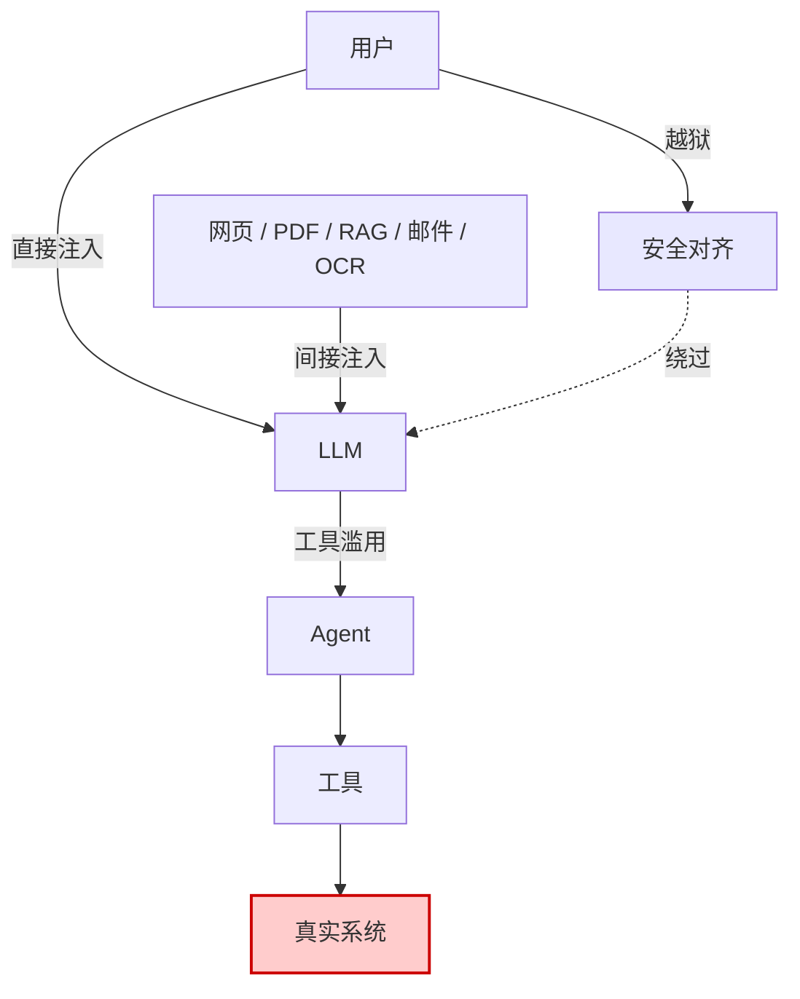

# Prompt 注入攻击类型谱系

## 核心结论

- 注入从直接用户输入演化为四类载体：**直接注入、间接注入、多模态注入、Agent 工具滥用**。
- 间接注入最危险：用户本身无恶意，Agent 却被第三方内容劫持。
- RAG 文档被模型当作"可信证据"处理，间接注入检测难度**极高**。
- Agent 场景风险随自主权与数据敏感度显著上升。

## 四类注入路径

<b>图1 四类注入路径总览</b>

## 直接注入

用户输入直接影响模型行为。常见手法：指令覆盖、套取系统提示、角色扮演绕过、编码与 Unicode 同形字检测绕过。

多语言/低资源语言是已验证的有效绕过路径[[1]](#ref-1)：Yong et al.（2023）实测表明，将恶意请求翻译为低资源语言可大幅降低模型拒绝率（与英文相比相差近两个数量级）。Base64 与不可见 Unicode 字符可携带人类不可见但模型可解析的指令。

## 间接注入

LLM 处理外部内容时，隐藏其中的指令在解析时生效。**其危险在于：用户本身无恶意，Agent 却被第三方内容劫持。**

| 载体 | 隐藏手法 | 检测难度 |
|---|---|---|
| 网页 | 隐藏文本、CSS 隐藏层、白字白底 | 中 |
| PDF | 不可见图层、元数据 | 中 |
| 图片 | 低对比度文字（多模态模型可解析） | 高 |
| 邮件 | HTML 注释、追踪像素配合 | 中 |
| RAG 文档 | 被模型当作"可信证据"处理 | **极高** |
| 工具返回 | 返回体中嵌入后续指令 | 高 |

## 多模态注入

恶意指令嵌入图像等非文本输入。攻击者可在图像上叠加低对比度文字——人类观察者几乎无法察觉，视觉语言模型却能成功解析并执行。

## Agent 与工具滥用

当模型能调用真实工具，注入不再只是"说错话"，而可能变成发邮件、转账、删文件、执行命令。

**已验证案例矩阵：**

| 时间 | 案例 | 入口 | 后果 |
|---|---|---|---|
| 2023.09 | Greshake et al. 插件攻击研究[[2]](#ref-2) | 网页 | 证明 LLM 可被间接注入操控第三方插件执行任意意图 |
| 2023.12 | Chevrolet 经销商 ChatGPT 机器人 | 客户对话 | 被诱导同意"$1 成交 Chevrolet Tahoe"并公开传播 |
| 2023–2024 | Bing Chat / Copilot Markdown 图片外泄链 | 恶意网页 | 注入使模型输出含攻击者 URL 的图片标签，聊天记录经 HTTP 请求外传 |
| 2024.05–09 | ChatGPT 长期记忆持久化注入[[3]](#ref-3) | 恶意网页/文件 | 注入写入长期记忆，形成持续窃取聊天记录的间谍软件 |
| 2024.11 | Claude Computer Use 演示 | 恶意网页 | 被诱导下载并运行文件，用户机器沦为僵尸网络节点 |
| 2025.06 | **EchoLeak（CVE-2025-32711）** | 一封邮件，零点击 | Microsoft 365 Copilot 读取内部文件并外传至攻击者服务器 |

## 相关页面

- [[Prompt注入定义与边界]]：注入的定义与越狱的区别
- [[EchoLeak零点击攻击案例]]：最严重注入案例的完整攻击链
- [[Prompt注入根因分析]]：为什么这些攻击在架构上无法避免
- [[Promptware Kill Chain]]：注入攻击的七阶段演化
- [[新兴Prompt注入攻击向量]]：2025-2026 新型攻击向量

## 参考来源

- [[raw/papers/Prompt注入与防范.md]]

---

[1] Z.-X. Yong, C. Menghini, S. H. Bach. ["Low-Resource Languages Jailbreak GPT-4."](https://arxiv.org/abs/2310.02446) *NeurIPS SoLaR Workshop*, 2023.
[2] K. Greshake et al. ["Not What You've Signed Up For: Compromising Real-World LLM-Integrated Applications with Indirect Prompt Injection."](https://arxiv.org/abs/2302.12173) *AISec@CCS*, 2023.
[3] J. Rehberger. ["Spyware Injection Into Your ChatGPT's Long-Term Memory (SpAIware)."](https://embracethered.com/blog/posts/2024/chatgpt-macos-app-persistent-data-exfiltration/) *Embrace The Red*, 2024-09-20.
