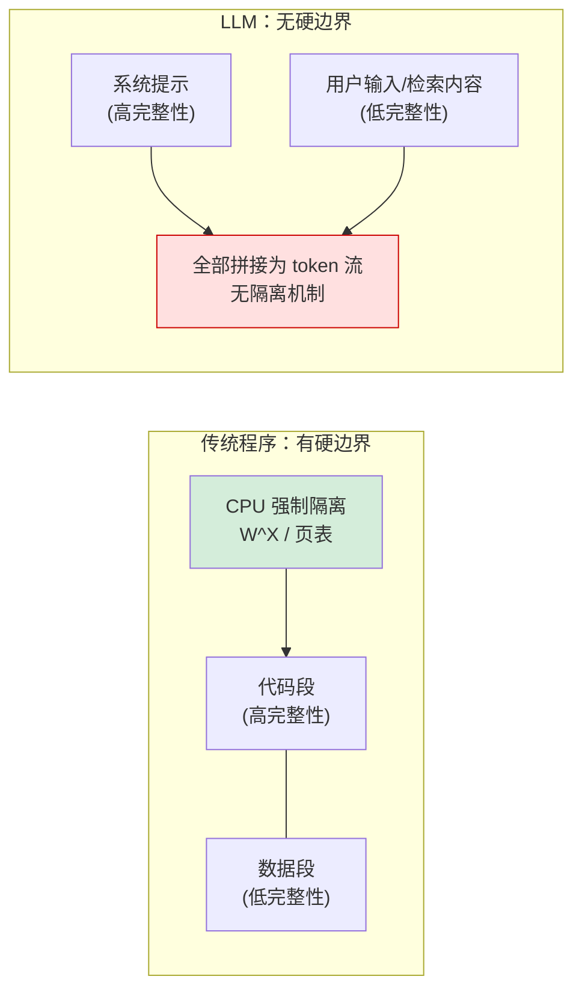

# Prompt 注入根因分析

## 核心结论

- **根因：LLM 没有"指令"与"数据"的天然边界。** 典型集成模式中，开发者把可信系统提示与不可信数据拼接成一个扁平字符串。
- 学术研究将其形式化为"**低完整性数据影响高完整性控制流**"（混淆代理问题）：注入本身是控制流完整性被破坏，数据泄露与未授权操作是后果。
- 2025 年 12 月，OpenAI 公开承认 Prompt 注入"不可能被彻底解决"[[1]](#ref-1)——这为"假设注入已发生、压缩影响面"的防御路线提供了产业界背书。

## 传统程序 vs LLM 的边界对比

<b>图1 传统程序与 LLM 的边界对比</b>

## 四个难以防御的原因

1. **黑名单不可靠**——自然语言有歧义，编码、多语言、角色扮演皆可绕过；
2. **模型是概率系统**——不是规则引擎，正则拦不住；
3. **系统提示可能泄露**——不能把"提示词保密"当安全边界；
4. **自适应攻击绕过率极高**——多项研究显示无单一检测技术能可靠阻止注入。

唯一可靠的路线是**架构分离**：确保 Agent 不同时具备"处理不可信输入、拥有写权限、访问机密信息"三者。

## 相关页面

- [[Prompt注入定义与边界]]：注入在 LLM 上下文中的发生机制
- [[纵深防御五原则]]：五条并行互补的防御原则
- [[Prompt注入架构层防御方案]]：StruQ/SecAlign/CaMeL 等架构级防御
- [[LLM-Agent安全防护总览]]：注入在 Agent 安全体系中的定位

## 参考来源

- [[raw/papers/Prompt注入与防范.md]]

---

[1] TechCrunch. ["OpenAI Says AI Browsers May Always Be Vulnerable to Prompt Injection Attacks."](https://techcrunch.com/2025/12/22/openai-says-ai-browsers-may-always-be-vulnerable-to-prompt-injection-attacks/) *TechCrunch*, 2025-12-22.
