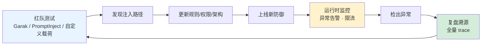

# Prompt 注入验证与运营

## 核心结论

- OWASP 建议在 CI 门禁中运行已知注入载荷并用评估标准对响应评分。
- 审计须保证完整 trace 可追溯。
- 监管视角正从**静态评估**转向**动态运行时治理**——从评估模型输出转向监控执行路径。

## 核心指标

注入拦截率、误报率、越权尝试次数、工具调用异常率、人工确认触发率、降级路径触发次数。

## 验证工具与基准

| 工具/基准 | 用途 | 关键数字 |
|---|---|---|
| **AgentDojo**[[1]](#ref-1) | 动态评估 Agent 效用与对抗鲁棒性 | 97 个真实任务、629 个对抗用例；指标：良性效用、攻击下效用、攻击成功率 |
| **Garak** | LLM 漏洞扫描器，含注入载荷库 | 可接入 CI 门禁 |
| **PromptInject** | 模块化注入测试框架 | 适配 OpenAI 类 API |
| **MCP Scan** | MCP 工具描述投毒扫描 | 覆盖 tool poisoning / rug pull |

## 验证与运营闭环

<b>图1 验证与运营闭环</b>

## 相关页面

- [[Prompt注入分层防御体系]]：六层防御体系
- [[新兴Prompt注入攻击向量]]：红队测试集需覆盖的新型载荷
- [[Prompt注入失效模式与降级方案]]：降级路径触发次数是核心指标之一
- [[Prompt注入防御实施路线]]：第三阶段运营的具体内容

## 参考来源

- [[raw/papers/Prompt注入与防范.md]]

---

[1] E. Debenedetti et al. ["AgentDojo: A Dynamic Environment to Evaluate Prompt Injection Attacks and Defenses for LLM Agents."](https://arxiv.org/abs/2406.13352) *NeurIPS Datasets & Benchmarks*, 2024.
