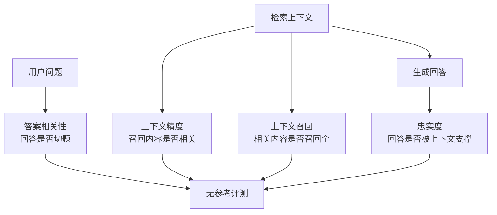

# RAGAS无参考指标

## 指标体系

<b>图1 RAGAS 无参考指标体系</b>

## 核心结论

- **RAG 评测须同时衡量检索与生成两侧**：检索器能否拿到相关上下文、生成器能否忠实利用上下文；只看答案流畅会掩盖事实缺陷[[大模型评测可信·素材摘要]]。
- **论文核心三项指标**（无参考，不需要人工标注的参考答案）：**忠实度（Faithfulness）**、**答案相关性（Answer Relevancy）**、**上下文相关性（Context Relevance）**；RAGAS **工具库**的实施进一步把上下文维度细分为**上下文精度（Context Precision）**与**上下文召回（Context Recall）** —— 引用 RAGAS 时须区分论文口径与工具库扩展。
- **忠实度是关键**：它直接衡量「回答是否被检索上下文支撑」，**比统计引用数量更接近证据可信的实质** —— 这正是[[可验证性四通道]]中「引用溯源」通道的指标化实现。

## 要点拆解

- **无参考的价值**：不需要为每个问题准备人工标准答案，可用 LLM 自动判分，因此能支撑 RAG 系统的快速迭代与持续回归；代价是判分本身依赖裁判质量，需按 [[LLM评委偏差与去偏差]] 做偏差控制。
- **指标分工**：忠实度查「有没有编」，答案相关性查「有没有答偏」，上下文精度/召回查「检索这一环好不好」，三者联用才能定位缺陷在检索侧还是生成侧。
- **与既有 RAG 页面的关系**：[[RAG准确率保障体系]] 讲绝对准确不可达的两条根因与架构/防护/兜底三组手段，本页提供**量化评测**这一环；[[RAG幻觉治理边界]] 给出 RAG 抑制幻觉的适用边界，本页的忠实度可作为是否越界的度量。
- **边界**：忠实度只判「回答是否被给定上下文支撑」，不判上下文本身是否事实正确 —— 上下文错误时，回答可以既「忠实」又「错误」，故需与程序化 ground truth 或可执行验证配合。

## 相关页面

- [[可验证性四通道]]：引用溯源通道在指标体系上的实现
- [[RAG准确率保障体系]]：RAG 准确率提升的三组手段
- [[RAG幻觉治理边界]]：RAG 抑制幻觉的适用边界
- [[LLM评委偏差与去偏差]]：无参考自动判分的偏差控制
- [[大模型评测可信体系总览]]：证据可信支线在四支柱中的位置
- [[大模型评测可信·素材摘要]]：素材出处

## 参考来源

- [[raw/papers/大模型评测可信.md]]
