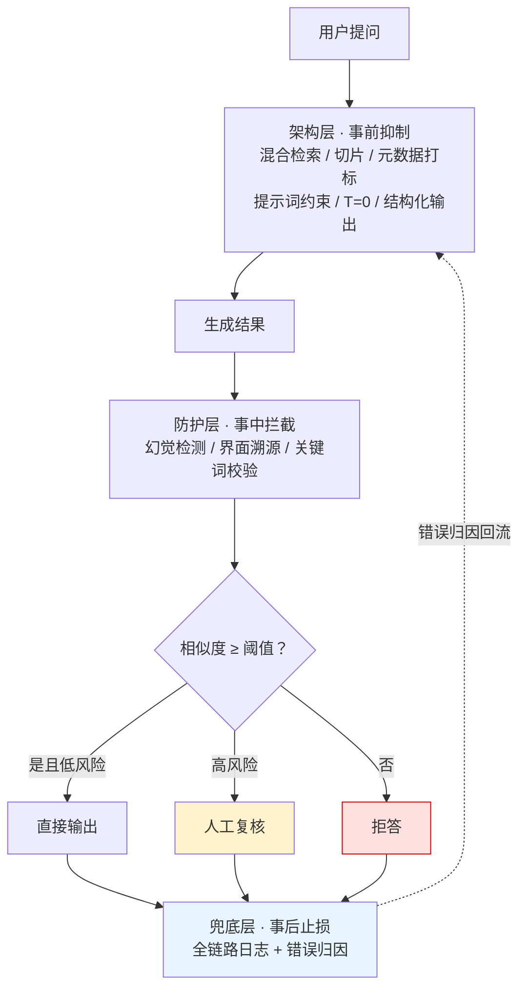

# RAG准确率保障体系

## 流程总览

## 核心结论

- **目标不是 100% 准确**，而是把出错概率压缩到业务可接受范围；类比物流体系——日均亿级包裹必然有错，但流程设计能把错误率压到极低。
- **三层各管一时机**：架构层管事前抑制（降低出错概率）、防护层管事中拦截（校验输出可靠性）、兜底层管事后止损（控制错误代价）。
- **核心思路**：把模型视为不可信的文本处理单元，用结构化契约约束其自由发挥空间——而不是试图让模型"更聪明"。

## 要点拆解

### 架构层 · 事前抑制

| 侧 | 手段 | 解决什么 |
|---|---|---|
| 检索侧 | 混合检索 | 稠密捕捉语义、稀疏锁定精确匹配，双路融合兼顾两类查询 |
| 检索侧 | 切片优化 | 按语义边界切分、保留上下文重叠，防止信息碎片化 |
| 检索侧 | 元数据打标 | 入库附加结构化标签（类别/时间/来源），支持按业务场景过滤召回 |
| 生成侧 | 提示词约束 | 限定仅依据上下文作答，禁止用自身知识补充 |
| 生成侧 | temperature=0 | 贪心解码消除采样随机性（但见下方边界） |
| 生成侧 | 输出格式限制 | 强制输出检索原文的结构化 JSON，阻断自主概括 |

检索侧三手段在 [[RAG检索优化五层]] 中已有工程量化口径；本页关注它们在**准确率**维度的角色差异——混合检索提升召回覆盖，切片优化防止语义被切碎，元数据打标过滤业务无关内容。

生成侧的关键边界：`temperature=0` **只消除采样扰动，切不断分布偏差**，贪心解码仍会稳定输出错误答案，详见 [[温度归零不消除系统性幻觉]]。

### 防护层 · 事中拦截

| 手段 | 机制 | 信任关系 |
|---|---|---|
| 幻觉检测 | 增设轻量校验模型，逐条比对生成内容与检索原文的匹配程度 | 模型内部校验 |
| 界面溯源 | 回答同步展示原文引用来源与具体内容，用户可自主比对 | 转移给用户核验 |
| 关键词校验 | 高风险行业构建领域词库，命中时校验关键词解释与原文是否一致 | 领域知识兜底 |

幻觉检测的分档策略：**全部有据放行 / 部分存疑标记 / 完全无据拒答**，对应 [[幻觉检测三条路径]] 中"在线一致性检测"的工程化落地形态。

界面溯源的设计意图是把信任关系从"盲信模型"转为"用户可核验"，详见 [[RAG界面溯源设计]]。

### 兜底层 · 事后止损

| 手段 | 机制 |
|---|---|
| 阈值控制 | 检索相似度低于阈值直接拒答，不让模型强行生成；阈值经离线标注 + 线上 A/B 标定 |
| 人工复核 | 高风险操作（处方开具、合同条款）自动回答后增设人工确认；低风险放行、高风险进审核队列 |
| 全链路日志 | 完整记录提问、检索、生成全流程，支持问题回溯与**错误归因（检索侧 or 生成侧）** |

阈值拒答与人工复核分别见 [[RAG阈值拒答机制]]、[[输出验证与人工审批]]；全链路日志的价值不在存储而在归因，见 [[监控闭环]]。

## 边界与澄清

| 易混概念 | 区别 |
|---|---|
| [[大模型兜底层]] | 那是**意图识别**的分层漏斗最后一层（5% 长尾请求转大模型处理），与本页的"拒答/复核/日志"兜底无关，**同名不同义** |
| [[防膨胀闸门]] | 那是知识库治理的素材准入闸门，与 RAG 运行时质量无关 |
| [[RAG幻觉治理边界]] | RAG 补知识截止，不自动解决忠实性；本页的幻觉检测属事中校验，不改变该边界 |

## 相关页面

- [[RAG绝对准确不可达]]：本页的前提认知
- [[Hybrid混合检索]]：架构层检索侧的既有实现细节
- [[RAG检索优化五层]]：检索侧五层组合拳与工程量化口径
- [[生成侧结构化约束]]：生成侧三项手段的契约化设计
- [[幻觉检测三条路径]]：防护层检测方法的学理来源
- [[RAG界面溯源设计]]：界面溯源的设计要点
- [[领域关键词校验]]：高风险行业的关键词校验
- [[RAG阈值拒答机制]]：兜底层第一道闸门
- [[输出验证与人工审批]]：高风险场景的人工复核队列
- [[温度归零不消除系统性幻觉]]：生成侧 T=0 的作用边界
- [[RAG质量三道闸门对比]]：本页三层与 RAG 权限隔离三道闸门的边界划分
- [[RAGAS无参考指标]]：本页三层手段的量化评测口径（忠实度/答案相关性/上下文相关性）
- [[可验证性四通道]]：界面溯源与忠实度在「证据可信」中的定位
- [[RAG质量保障主题]]：本页所属主题页
- [[RAG准确率提升·素材摘要]]：本页的素材来源

## 参考来源

- [[raw/papers/RAG准确率提升.md]]