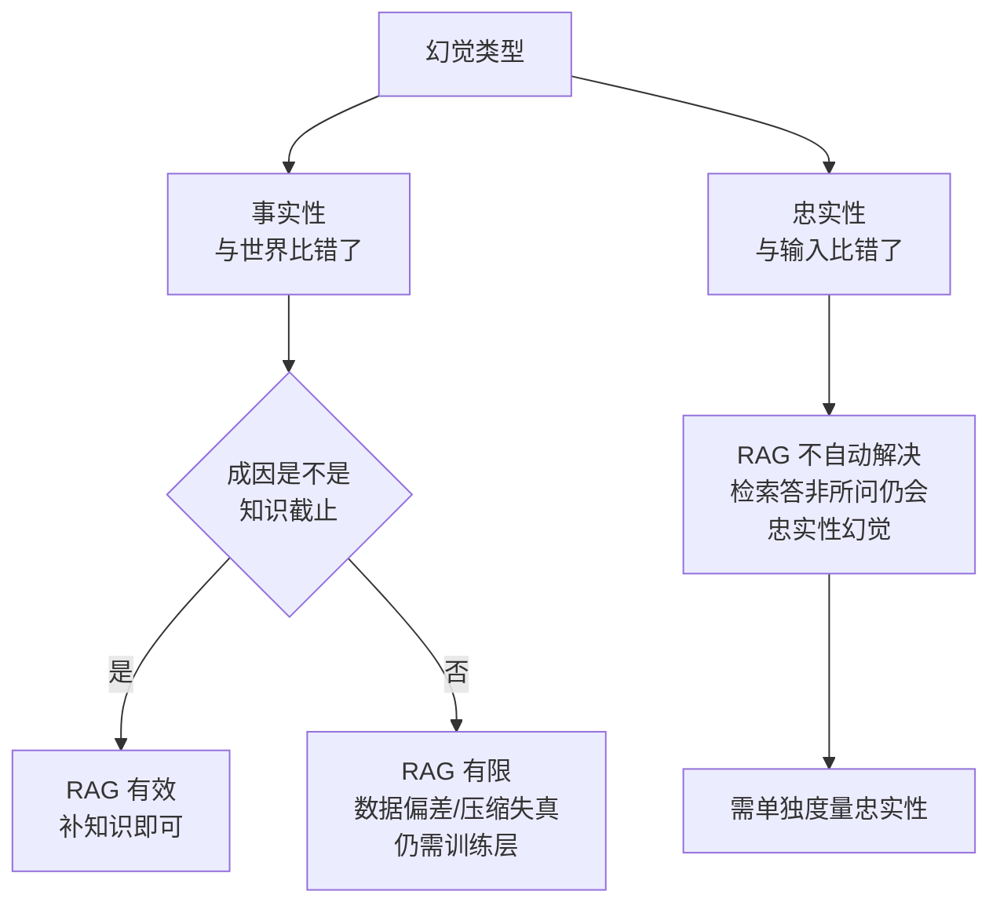

# RAG幻觉治理边界

## 核心结论

**RAG 补的是知识截止，不是忠实性。检索解决「没听说过」，不自动解决「答非所问」。**

这条边界常被误读为「上了 RAG 就不会幻觉了」。实际上 RAG 只对 [[幻觉成因四条线]] 中的知识截止一条线直接有效；对数据偏差、采样随机性、压缩失真要么无效、要么需要配合。

## 要点拆解

### RAG 对四条成因线的效果

| 成因线 | RAG 效果 | 说明 |
|---|---|---|
| 知识截止 | **直接有效** | 检索到边界后的新知识 |
| 数据偏差 | 有限 | 检索结果本身可能有偏 |
| 采样随机性 | 无效 | 与上下文无关 |
| 压缩失真 | 有限 | 长尾细节仍可能被插值 |

### 为什么检索了还会答非所问

即使检索到正确文档，模型仍可能：

- **引用了文档里没有的内容**——这是忠实性幻觉，RAG 不管；
- **检索本身就错了**——query 改写、排序、切分任何一环出错，喂给模型的上下文就是错的，详见 [[RAG检索优化五层]]；
- **检索到了但没用**——上下文过长，关键片段被淹没。

### 摘要、翻译、RAG 这类任务要单独度量忠实性

以源文档为锚的任务，「对不对」的判据已经从世界知识换成了给定材料。此时模型输出一句在世界中为真、但源文档里没有的话，依然构成幻觉。

因此**RAG 系统的评估指标不能只有事实性准确率，必须包含忠实性度量**（如引用覆盖率、忠实性分数），度量手段见 [[幻觉检测三条路径]]。

### 与微调的分工

RAG 与微调的分工已有既有结论：微调管「怎么说」、RAG 管「知道什么」，见 [[微调与RAG分工]]。本页补充的是**边界**：RAG 管的「知道什么」只覆盖知识截止一条线，剩下的仍需训练层与系统层。

## 相关页面

- [[事实性幻觉与忠实性幻觉]]：本页两类切分的基准。
- [[RAG检索优化五层]]：检索质量是 RAG 有效的前置条件。
- [[微调与RAG分工]]：与微调的能力边界。
- [[幻觉三层治理框架]]：RAG 在推理层的位置。

## 参考来源

- [[raw/papers/大模型幻觉成因与分层治理.md]]
