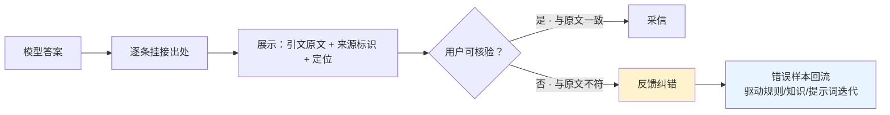

# RAG界面溯源设计

## 设计流程

## 核心结论

- **核心设计意图**：把信任关系从「盲信模型」转为「**用户可核验**」。这是唯一一个把验证责任交给人的手段。
- **零拦截成本**：不拦截、不重算、不增加模型调用，只在 UI 层多渲染一层引文——因此它**不消耗推理预算**，可与任何检测手段叠加。
- **它是最后一道防线而非第一道**：用户核验是事后行为，无法阻止错误被读到；因此溯源应与 [[幻觉检测三条路径|幻觉检测]] 组合使用，而不是用它替代检测。

## 要点拆解

### 最小实现

| 要素 | 要求 |
|---|---|
| 引文原文 | 展示实际被用于作答的检索片段原文，而非摘要或改写 |
| 来源标识 | 文档名 + 版本/更新时间 + 业务域，让用户能判断"这条知识是否过期" |
| 定位 | 支持点击跳转/高亮到原文位置，便于比对 |
| 逐条挂接 | 按答案中的每个论断挂接，粒度对齐 [[生成侧结构化约束]] 的 Schema |

### 为什么"展示原文"比"展示链接"更重要

只给链接的问题是：用户需要额外跳转、且多数用户不会跳转，实际核验率趋近于零。**把引文原文直接呈现在答案旁边**，才能真正把核验权利用起来。

### 与其他手段的分工

| 手段 | 谁来验证 | 时机 | 拦截能力 |
|---|---|---|---|
| 界面溯源 | 用户 | 读答案时 | 弱（事后、依赖用户意愿） |
| 幻觉检测 | 模型/规则 | 生成后 | 中（可自动拦截） |
| 阈值拒答 | 系统 | 生成前 | 强（前置硬闸门） |
| 人工复核 | 人工 | 输出前 | 强（高风险终审） |

四者构成 [[RAG准确率保障体系]] 防护层的完整组合。

## 落地注意

- **过期知识要显式标注**：RAG 的核心风险之一是检索到过期文档，溯源界面应展示版本与时间，否则用户核验的是"一条过期的正确答案"。
- **引文与答案不一致要可反馈**：用户点"这段原文没说"应能直接形成纠错样本，进入 [[监控闭环]] 的错误归因流程。
- **医疗/金融场景强制溯源**：高风险场景下不提供溯源的 RAG 回答不应上线。

## 相关页面

- [[RAG准确率保障体系]]：本页所属的防护层
- [[生成侧结构化约束]]：逐条挂接出处的 Schema 来源
- [[幻觉检测三条路径]]：生成后的自动校验手段
- [[RAG阈值拒答机制]]：前置硬闸门
- [[上下文污染]]：溯源可暴露检索内容被污染的情况
- [[监控闭环]]：纠错样本的归因回流

## 参考来源

- [[raw/papers/RAG准确率提升.md]]