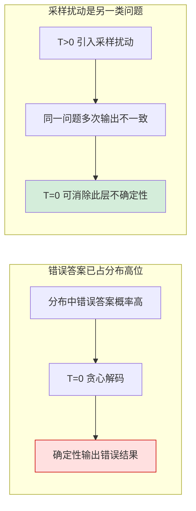

# RAG绝对准确不可达

## 核心结论

**RAG 无法实现 100% 准确率**，这是大模型固有的随机性决定的。可行目标不是追求绝对正确，而是将出错概率压缩到业务可接受范围。

## 要点拆解

### 为何不可达

两条根因，且**均属架构级固有属性**：

| 根因 | 性质 | 可缓解手段 | 根治手段 |
|---|---|---|---|
| 采样解码的随机性 | 架构固有 | temperature=0 消除采样扰动 | 无 |
| 训练分布偏差 | 架构固有 | RAG 补知识截止、增强上下文 | 训练侧修正分布 |

调参只能缓解，无法根治。

### temperature=0 的作用边界（关键误解澄清）

「把 temperature 归零就能消除错误」是最常见的误解。真实机理是：

**T=0 只切断采样扰动，切不断分布偏差**——若错误答案在模型输出分布中已占高位，贪心解码会**确定性地稳定输出错误结果**，且此时错误率可能高于带随机性的场景（因为失去了偶然纠正的机会）。

更完整的机理见 [[温度归零不消除系统性幻觉]]，采样机制本体见 [[温度参数与生成采样]]。

### 可行路径：物流类比

日均亿级包裹的物流体系必然存在出错，但通过流程设计（分拣校验、异常拦截、开箱复核）可将错误率压至极低水平。RAG 同理——正确做法是从**工程与业务双维度**降低出错概率，而非追逐不可能的零错误。

这一类比直接推导出 [[RAG准确率保障体系]] 的三层结构：事前抑制、事中拦截、事后止损。

## 相关页面

- [[RAG准确率保障体系]]：本页认知推导出的一页
- [[温度归零不消除系统性幻觉]]：T=0 边界的完整论述
- [[温度参数与生成采样]]：采样机制本体
- [[大模型幻觉定义与本质]]：随机性与分布偏差的上游成因
- [[幻觉成因四条线]]：训练分布偏差在幻觉成因体系中的位置
- [[RAG幻觉治理边界]]：RAG 能补什么、不能补什么

## 参考来源

- [[raw/papers/RAG准确率提升.md]]