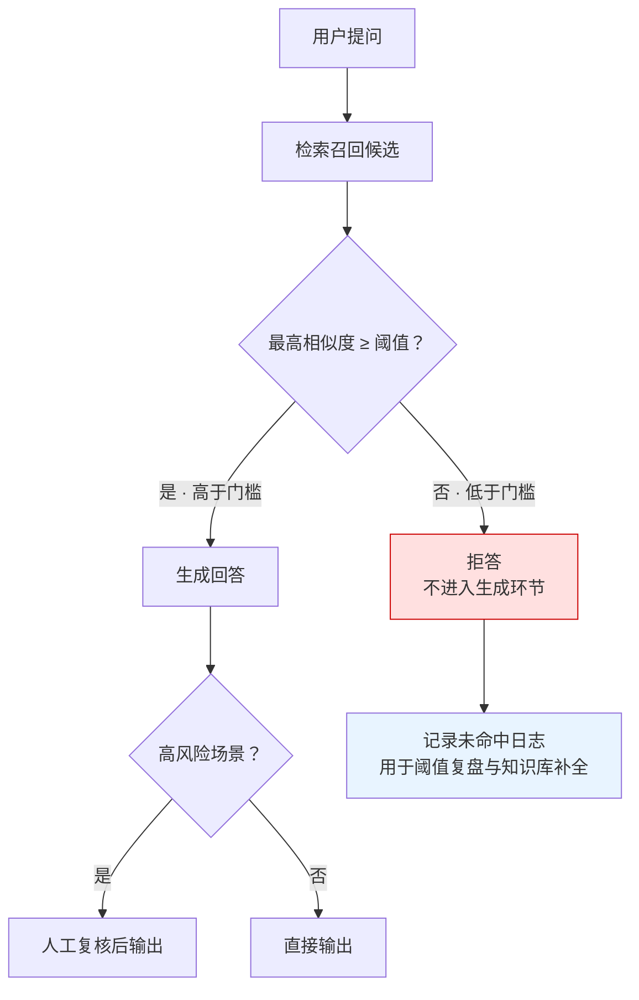

# RAG阈值拒答机制

## 决策流程

## 核心结论

- **拒答优先于强行生成**：相似度低于门槛时，让模型基于无关上下文作答，比直接说"不知道"危害更大——因为输出看起来是流畅且可信的。
- **阈值不是拍脑袋**：需经**离线标注集**标定起点，再经**线上 A/B 实验**按业务可接受的拒答率与准确率权衡调整。
- **拒答率是业务指标不是技术缺陷**：医疗/法律/金融场景拒答率高是合理的；通用客服场景拒答率过高说明知识库覆盖不足。

## 要点拆解

### 阈值怎么定

| 阶段 | 做法 | 产出 |
|---|---|---|
| 离线 | 人工标注一批 query 与其正确答案的相似度分布 | 初始阈值候选 |
| 线上 A/B | 按拒答率 / 准确率 / 用户满意度三指标权衡 | 上线阈值 |
| 复盘 | 统计未命中 query 的共性，转化为知识库补全任务 | 阈值回调 + 知识补全 |

阈值应与 [[置信度阈值]] 属同一族问题：都是"多大概率才敢输出"的决策，只是 RAG 侧判定的是**检索相似度**而非模型自身置信度。

### 与其他手段的关系

| 手段 | 拦截时机 | 拦截依据 | 与阈值拒答的关系 |
|---|---|---|---|
| 阈值拒答 | 生成前 | 检索相似度 | 前置闸门，成本最低 |
| 幻觉检测 | 生成后 | 输出与原文匹配度 | 后置闸门，补前置的漏网 |
| 人工复核 | 输出前（高风险） | 场景风险等级 | 终审闸门，成本最高 |

三层并用构成 [[RAG准确率保障体系]] 的防护层与兜底层。

### 拒答的正确话术

拒答不等于"我不知道"。工程上应区分并给出可行动指引：

- **检索未命中**：告知未找到相关内容，建议换用词或转人工；
- **知识库缺失**：建议提问已被记录，将补充知识；
- **超出能力范围**：明确边界，避免用户反复追问造成二次幻觉。

## 相关页面

- [[RAG准确率保障体系]]：本页所属的兜底层
- [[置信度阈值]]：阈值决策的通用问题族
- [[幻觉检测三条路径]]：生成后的兜底检测
- [[输出验证与人工审批]]：高风险场景的终审闸门
- [[RAG检索优化五层]]：阈值与召回策略（④ 阈值/动态 K）的既有工程口径
- [[监控闭环]]：未命中日志的复盘闭环
- [[RAG绝对准确不可达]]：拒答策略的前提认知

## 参考来源

- [[raw/papers/RAG准确率提升.md]]