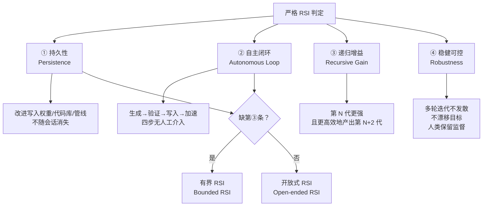
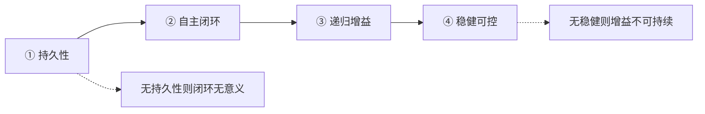

# RSI四项判定标准

## 核心结论

四项标准是**递进的闸门，不是并列的加分项**：前两条是「能不能自动改进」的入场券，第三条是「改进会不会复利」的分水岭，第四条是「能不能持续而不失控」的兜底。

**缺第三条而只满足前两条的系统称为有界 RSI（Bounded RSI）**；四条齐备才构成开放式递归自我改进。现实中的绝大多数系统停在前两条。

## 要点拆解

### ① 持久性：改进必须落到文件系统上

判据：改进写入**权重、代码库或管线**，而非随会话消失。

| 达标形态 | 不达标形态 |
|---|---|
| 更新模型权重 | 只改了这轮对话的提示词 |
| 提交代码到仓库 | 只在内存里改了变量 |
| 修改训练/推理管线配置 | 会话结束即丢失的临时状态 |

**工程检查法**：重启进程后，改进还在不在？不在就不算持久。

### ② 自主闭环：四步无人工介入

判据：**生成 → 验证 → 写入 → 加速**四步能无人工介入地循环。

这条最容易被高估。多数所谓「自我改进系统」实际卡在「验证」或「写入」需要人点头。四步里任何一步需要人类介入，闭环就断了——它变成「人类驱动的改进流水线」，不是自主闭环。

**工程检查法**：人离开一周，系统还能自己迭代下一代吗？

### ③ 递归增益：复利而非线性

判据：第 $N$ 代更强，且**因继承更好的研发机制而更高效地产出第 $N+2$ 代**——即改进产生复利。

注意判据里写的是 $N+2$ 而不是 $N+1$。这个下标差异是关键：只看 $N+1$ 更强，只能证明「这轮有效」（自我改进层也能做到）；能证明「下一轮产出得更快」，才证明改进能力本身被改进了。

**这条正是 [[点火条件与复利因子G]] 中复利因子 $G$ 所量化的对象**：当且仅当 $G>1$，递归增益成立，系统从有界跨入开放式。

**工程检查法**：同样工作量下，第 N+2 代的设计周期是否短于第 N 代？不是就走了线性路。

### ④ 稳健可控：不发散、不漂移

判据：多轮迭代不发散、不漂移目标，人类保留监督。

跨代迭代最大的风险不是能力不涨，而是**目标漂移**——每代都朝「更符合评估器」而不是「更符合意图」偏一点，多代累积后彻底跑偏。这与 [[机器学习安全四大类别]] 中「对齐」一栏的奖励黑客问题同源，也对应 RSI 的第四类局限「对齐退化」。

**工程检查法**：第 N 代的目标定义是否还等于第 0 代？谁在守这条线？

### 四条的依赖关系

**顺序含义**：前一条不成立时，后面条目的验证没有意义。评估一个自称 RSI 的系统，应按 ①→②→③→④ 的顺序逐项否证，最容易暴露问题的是第 ② 条（多数系统在这里就断了）。

## 相关页面

- [[递归自我改进RSI]]：定义与概念边界，本页的上位页。
- [[有界RSI与开放式RSI]]：第 ③ 条成立与否带来的本质分层。
- [[点火条件与复利因子G]]：第 ③ 条的量化判据。
- [[机器学习安全四大类别]]：第 ④ 条面对的对齐与奖励黑客风险。
- [[递归自我改进总览]]：本页所属的领域全景。

## 参考来源

- 线上原文：[https://arxiv.org/abs/1502.06512](https://arxiv.org/abs/1502.06512)（Yampolskiy 2015）
- [[raw/papers/RSI递归自我改进.md]]（§1.2 关键特征与判定标准）
