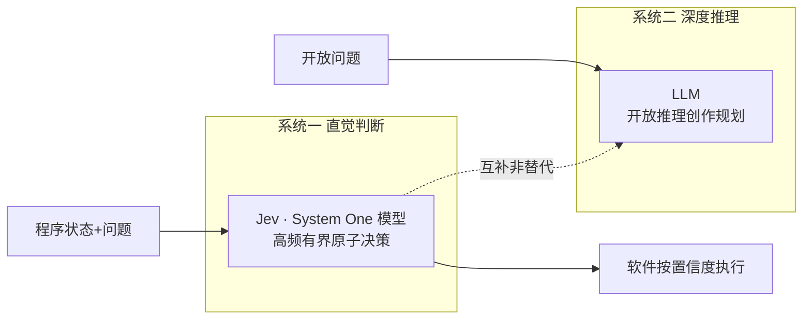

# System One 模型

## 定义

**System One 模型**是一类面向机器判断的 AI 模型形态：输入一份非结构化状态 + 一组预先定义的问题，输出**带校准概率的类型化决策**，而非自然语言文本。命名取自卡尼曼（Daniel Kahneman）双系统理论——**系统一是快速、直觉、自动化的反应**，与之相对的系统二是缓慢、深思熟虑的推理。

## 品类定位

- **Jev 是首个落地实例**：TypeSafe AI 于 2026-09-15 发布，官方称其为「系统一模型」这个新品类在工业界的首次落地。见 [[Jev 决策模型]]。
- **与 LLM 的分工**：LLM 对应系统二的深度推理（开放创作、规划），System One 模型对应系统一的直觉判断（分类、路由、评分、守门）。见 [[Jev 与传统 LLM 对比]]。
- 它不是「又一个更便宜的 GPT」，而是一类全新的模型形态。

## 关键特征

1. **不生成文本**：刻意不做大语言模型做的事，返回结构化判断供程序直接读取。
2. **类型化 + 校准置信度**：答案被约束在预定义类型，且每个决策带概率。见 [[类型化输出]]、[[校准置信度]]。
3. **面向机器的接口**：官方称为「更像代码」——可靠、快速、自洽、类型安全。

## 为什么被需要

生成式 LLM 与机器决策存在结构性错配：自回归文本生成器输出「人看的文本」，而机器通信需要「给程序用的结构」。RLHF 又进一步把 LLM 优化成讨好人类的聊天机器。System One 模型补上自动化系统里「软件可直接依赖的判断接口」这一空缺。

## 局限

尚处早期：首个实例权重未开放、独立校准数据稀少，性能数字多为厂商自测，是否为范式转变仍需验证。

## 相关导航

- 实体：[[Jev 决策模型]]、[[TypeSafe AI]]
- 总览：[[Jev 决策模型总览]]
- 对比：[[Jev 与传统 LLM 对比]]
- 原理：[[决策原语]]、[[类型化输出]]、[[并行采样机制]]、[[校准置信度]]
- 素材摘要：[[Jev决策模型·素材摘要]]

