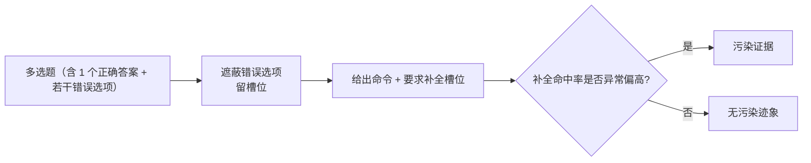

# TS-Guessing污染检测

## 机制

<b>图1 TS-Guessing 检测流程</b>

## 核心结论

- **原理**：把多选题中除正确答案外的选项替换为槽位并给出补全命令，让模型填回缺失内容；如果模型能高命中率地还原这些本不该出现在语料里的内容，就说明它见过这道题，即存在测试集污染。
- **关键优势是不需要拿到训练语料**：与[[基准污染与动态基准]]中的检索比对不同，检索比对依赖「已知语料 + 可复现」前提，只适用于开源模型与已知语料；TS-Guessing 在闭源模型上同样可用。
- 该方法已在闭源与开源模型上均证实现代基准存在污染，是数据污染调查类研究的主力证据之一。

## 要点拆解

- **与检索比对的分工**：检索比对是「有语料就查重叠」的直接取证，TS-Guessing 是「无语料就用行为反推」的间接取证，两者互补构成检测侧的双通道。
- **判读边界**：命中率多少算「异常」存在**阈值主观性**，单一结果不足以定案，需要与训练数据检查、成员推断、时间序证据等多条链路交叉确认。
- **与防御的关系**：检测只能事后发现问题，真正避免污染要靠动态题源、程序化出题等防御手段，见[[基准污染与动态基准]]与[[LiveBench]]。

## 相关页面

- [[基准污染与动态基准]]：污染的完整风险图谱与检测/防御两张清单
- [[LiveBench]]：以动态题源从设计上规避污染的基准
- [[大模型评测可信体系总览]]：基准可信支线在四支柱中的位置
- [[大模型评测可信·素材摘要]]：素材出处

## 参考来源

- [[raw/papers/大模型评测可信.md]]
