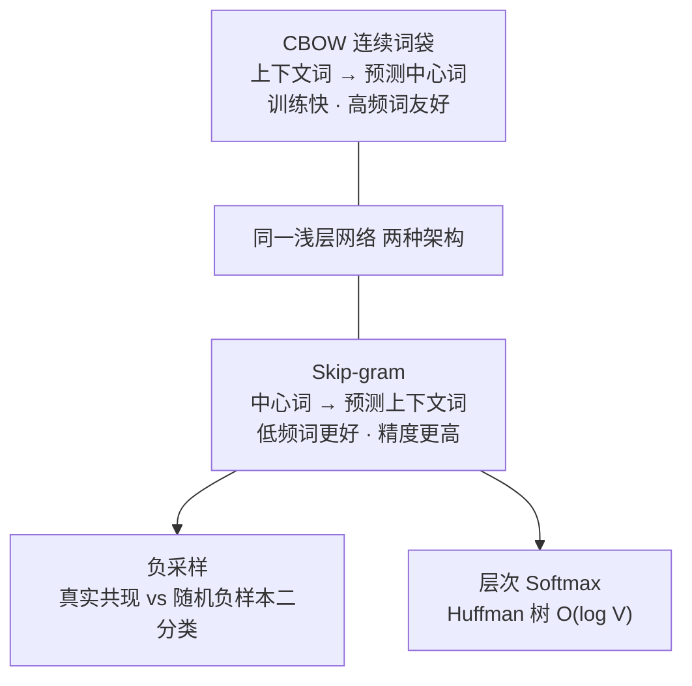

# Word2Vec

## 核心结论

Word2Vec 由 Mikolov 团队提出 [[2]](#ref-2)[[3]](#ref-3)，本质是一个浅层神经网络，预测式学习静态词向量；工程可行性靠负采样（5~20 个负样本替代全词表 Softmax）与层次 Softmax（Huffman 树，O(V) 降 O(log V)）两大技巧撑起。

图 1 Word2Vec 两种训练架构与两大加速技巧

## 要点拆解

### 两种训练架构

- **CBOW（连续词袋）**：用上下文词预测中心词，如给定 "the cat ___ on the" 预测 "sat"，训练快、对高频词效果好；
- **Skip-gram**：用中心词预测上下文词，对低频词效果更好、精度更高。

### 核心加速技巧

- **负采样** [[3]](#ref-3)：不做全词表 Softmax，把多分类转为二分类——判断「（中心词，上下文词）」是真实共现还是随机拼凑的负样本，每个正样本只需 5~20 个负样本；
- **层次 Softmax** [[2]](#ref-2)：用 Huffman 树组织词表，复杂度从 O(V) 降到 O(log V)；
- **高频词下采样**：对 the、of 一类词按频率丢弃；
- **动态窗口**：训练时在 [1, w] 内均匀随机缩短实际窗口。

### 容易忽略的实现细节

训练后网络里保留输入矩阵与输出矩阵两套参数，常见实现取输入矩阵作为词向量，但也有取输出矩阵、或二者平均/拼接的，具体取法视实现而定。

## 相关页面

- [[GloVe]]：统计式路线，与预测式互为基线。
- [[FastText]]：子词建模路线。
- [[静态嵌入方案对比]]：三方案与传统方法横向对照。
- [[词嵌入]]：分布式假设与度量基础。
- [[词嵌入·素材摘要]]：本页所在素材全篇索引。

## 参考来源

[[raw/papers/词嵌入.md]]
