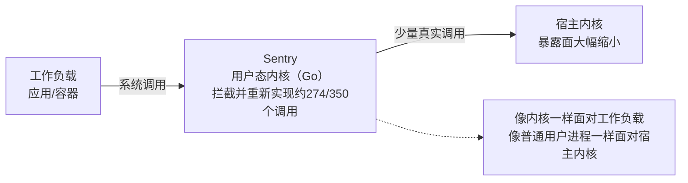

# gVisor用户态内核

## 核心结论

gVisor 用 Go 实现了**用户态内核 Sentry**，拦截并重新实现 Linux 系统调用（amd64 下约 274/350 个），宿主内核暴露面大幅缩小——**像内核一样面对工作负载，像普通用户进程一样面对宿主内核**。

它在 [[隔离技术谱系]] 中处于容器与 microVM 之间：比容器多一层重新实现的内核，比 microVM 少一层硬件虚拟化。

## 要点拆解

### 与 microVM 的关键区别

**它不需要 KVM 或裸金属**，可以跑在普通虚拟机内部：

- 部署成本显著更低；
- 更便于与既有异构计算环境集成；
- 代价是系统调用密集型负载有性能损耗；
- 且重新实现 Linux ABI 带来兼容性验证负担。

### 生产规模验证

腾讯在 Agentic-RL 场景**日均运行数百万个 gVisor 沙箱**，是用户态内核路线在极致规模上的实证。与之呼应，[[Agent沙箱平台横评]] 中 Modal 基于 gVisor 可扩至 5 万到 10 万以上并发——用户态内核路线在规模上有独到优势。

### 为什么它成了「容器 + 加固」的默认选项

[[容器逃逸与沙箱绕过]] 的结论是「任意不可信代码 + 多租户」场景下容器已知不充分。gVisor 保留了容器的镜像与编排生态，却把内核暴露面压下来，因此成为以容器换冷启动的平台所额外提供的加固选项——[[Agent沙箱平台横评]] 中 Daytona 提供 gVisor / Kata 可选即为例证。

## 相关页面

- [[隔离技术谱系]]：gVisor 在共享强度链上的位置。
- [[Firecracker微虚拟机]]：同为百毫秒级，但走硬件虚拟化路线的对比项。
- [[沙箱隔离技术选型对比]]：两者在启动延迟、内存开销与适用场景上的对照。
- [[容器逃逸与沙箱绕过]]：gVisor 作为加固选项的动因。
- [[Agent沙箱技术全景总览]]：本页所属的领域全景。

## 参考来源

- [[raw/papers/Agent沙箱.md]]
