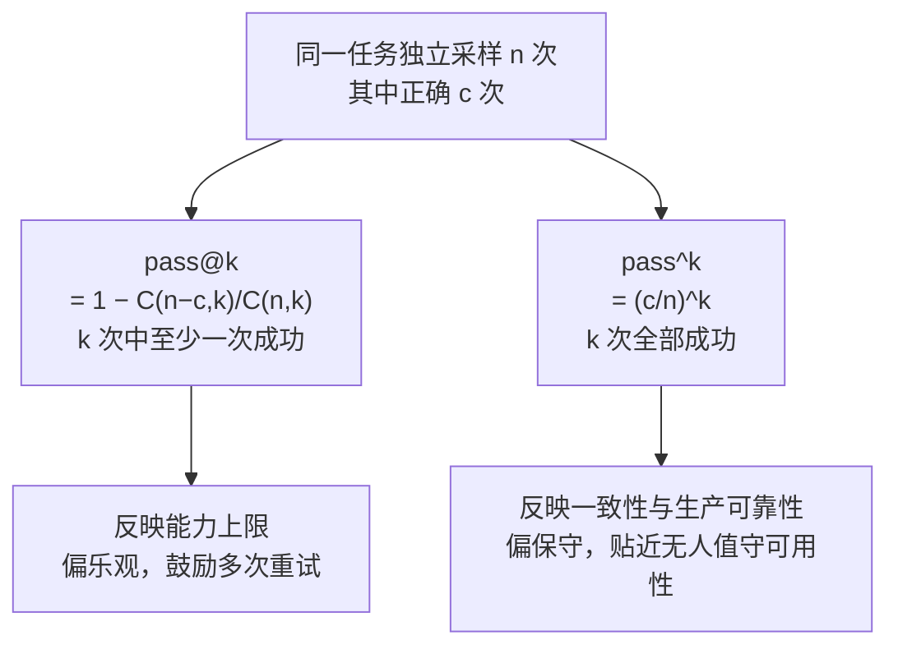

# pass@k与pass^k

## 语义对照

<b>图1 pass@k 与 pass^k 的语义差异</b>

## 核心结论

- 两者符号相近、语义相反，是 Agent 评估里最易混淆的一对指标。
- **pass@k** 回答「能不能做到」，反映**能力上限**；**pass^k** 回答「能不能每次都做到」，反映**行为一致性与生产可靠性**。
- 对会改变真实世界状态的 Agent（订票、下单、写数据库），**真实用户不会无限重试，pass^k 才是更诚实的生产指标**。

## 数学定义

设同一任务独立采样 $n$ 次、正确 $c$ 次。

**pass@k**（由 HumanEval 提出，衡量从 $n$ 次中抽 $k$ 次至少一次成功的无偏估计）

$$\text{pass@}k = 1 - \frac{\binom{n-c}{k}}{\binom{n}{k}}$$

**pass^k**（由 [[τ-bench]] 提出，即单次成功率 $c/n$ 的 $k$ 次方）

$$\text{pass}^k = \left(\frac{c}{n}\right)^k$$

【推导】以单次成功率 70%、$k=3$ 为例，$\text{pass@}3 \approx 1-0.3^3 = 97.3\%$，$\text{pass}^3 = 0.7^3 = 34.3\%$，相差近三倍。

## 要点拆解

- **实测水位**：τ-bench 中 gpt-4o 级别智能体在 retail 域任务成功率不足 50%、pass^8 低于 25%。
- **误用风险**：仅报告 pass@k 会系统性高估可靠性——只看「多次采样中的最好成绩」会严重误判无人值守可用性。
- **使用纪律**：可靠性永远**同时看 pass@k 与 pass^k**，前者看能力天花板、后者看稳定性；生产监控以 pass^k 为主，见 [[Agent评估组合策略]]。
- 指标本身由 [[结果评估]] 产出，属于评估链条的最后一环。

## 相关页面

- [[结果评估]]：产出成功率指标的评估对象层
- [[τ-bench]]：pass^k 的提出者与实测水位来源
- [[Agent评估体系总览]]：指标层在五层结构中的位置
- [[四类评估方法对比]]：指标与方法的关系
- [[持续评估]]：把成功率固化为 CI 回归门槛

## 参考来源

- [[raw/papers/Agent轨迹评估和结果评估.md]]
- [Evaluating Large Language Models Trained on Code](https://arxiv.org/abs/2107.03374)，arXiv:2107.03374
- [τ-bench: A Benchmark for Tool-Agent-User Interaction in Real-World Domains](https://arxiv.org/abs/2406.12045)，arXiv:2406.12045
