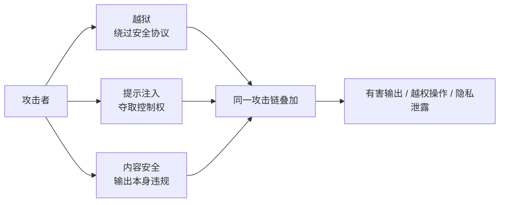

# 三大威胁向量

## 核心结论

- 大语言模型部署后，攻击者主要从**三类通道**诱导模型越过安全边界，其中前两类被 OWASP GenAI Security Project 纳入 LLM 应用十大风险清单[[2]](#ref-2)。
- **越狱**：精心构造输入，使模型完全无视自身安全协议；**提示注入**：将恶意指令混入模型可见的输入流，覆盖或篡改系统提示；**内容安全**：模型在正常或对抗输入下生成违规有害内容。
- 概念关系：**越狱是提示注入的特例**——OWASP 将其定义为「使模型忽略安全协议的提示注入形式」；越狱/提示注入聚焦「绕过策略或夺取控制权」，内容安全聚焦「输出本身的合规性」，三者常在同一攻击链上叠加出现。

## 攻击面分类

<b>图1 三大威胁向量与叠加关系</b>

| 威胁 | 攻击原理 | 典型手段 | 主要危害 | 防御方向 |
|---|---|---|---|---|
| 越狱 | 精心构造输入以使模型完全无视自身安全协议[[2]](#ref-2) | 角色扮演、多轮诱导、GCG 梯度搜索后缀[[3]](#ref-3) | 生成武器制造、非法活动指导等有害内容 | 拒绝方向强化、分类器防御[[7]](#ref-7) |
| 提示注入 | 将恶意指令混入模型可见的输入流（用户消息、RAG 文档、工具返回等），覆盖或篡改系统提示[[2]](#ref-2) | 直接注入、间接注入、目标劫持、信息泄露 | 操纵 Agent 行为、劫持工具调用、泄露隐私数据 | 通道隔离、输入输出过滤、权限最小化 |
| 内容安全 | 模型在正常或对抗输入下生成违规有害内容 | 毒性续写、偏见触发、PII 泄露、训练数据反演 | 仇恨言论、歧视输出、隐私泄露 | 内容分类器、输出过滤、人工审核 |

## 相关页面

- [[AI安全与红队测试总览]]：本页所在的上位总览
- [[越狱攻击]]：越狱向量的机理与防御展开
- [[红队测试四步闭环]]：清单阶段需覆盖三类威胁的覆盖度基线
- [[提示词注入]]：提示注入在 Agent 场景的成因与分类（既有沉淀）
- [[LLM-Agent安全防护总览]]：提示注入的纵深防御体系
- [[机器学习安全四大类别]]：防御侧的四道防线

## 参考来源

- [[raw/papers/AI安全与红队测试.md]]

---

[2] OWASP Foundation. [OWASP Top 10 for LLM Applications v2.0](https://genai.owasp.org/llm-top-10/) *genai.owasp.org*, 2025.
[3] A. Zou et al. [Universal and Transferable Adversarial Attacks on Aligned Language Models](https://arxiv.org/abs/2307.15043) *arXiv:2307.15043*, 2023.
[7] M. Sharma et al. [Constitutional Classifiers](https://arxiv.org/abs/2501.18837) *arXiv:2501.18837*, 2025.
