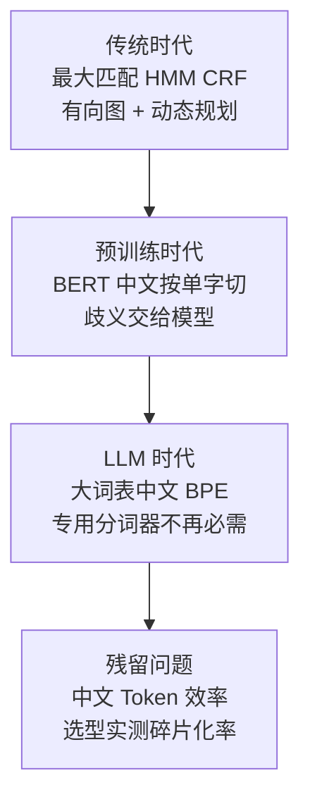

# 中文分词特例

## 核心结论

中文分词经历了「专门技术栈 → 逐渐内化」的过程：预训练时代之前靠规则与统计方法硬切，预训练时代后 BERT 中文版直接按单字切、大词表模型普及中文 BPE，歧义消解由模型在上下文中隐式完成；真正残留的问题是 Token 效率，新词表已大幅缓解但选型前仍要实测碎片化率。

图 1 中文分词技术形态的三个阶段与残留问题

## 要点拆解

### 无空格与切分歧义

中文没有空格分隔，还自带切分歧义，经典句子「南京市长江大桥」可切出「南京市/长江大桥」与「南京市长/江大桥」两种切法，是检验分词器的老谜题。

### 传统方法

- **规则路线**：正向与反向最大匹配、最短路径法；
- **统计路线**：HMM 与 CRF 序列标注；
- **工程路线**：把词典建成有向图再用动态规划求最优切分。

### 深度学习时代

BERT 中文版直接按单字切，中文 BPE 随大词表模型普及，LLM 时代专门的分词器不再是必需品。

### 中文 Token 效率

- 早期词表下同一个意思中文常比英文消耗更多 token，GPT-4 的 cl100k 词表下一个汉字经常要占 1 到 2 个 token；
- 词表涨到约 20 万的 o200k 之后降到约 0.5 至 0.75；
- 同等中文内容的计费与上下文占用明显下降，选模型时值得用自己的真实语料算一遍碎片化率，而不只看词表大小。

## 相关页面

- [[SentencePiece]]：空格记 ▁ 的语言无关设计对中文的意义。
- [[分词质量评估]]：碎片化率的正主。
- [[词表大小权衡]]：cl100k 到 o200k 效率差异的根源。
- [[Tokenizer分词编码]]：分词在推理流水线中的整体位置。
- [[Token分词·素材摘要]]：本页所在素材全篇索引。

## 参考来源

[[raw/papers/Token分词.md]]
