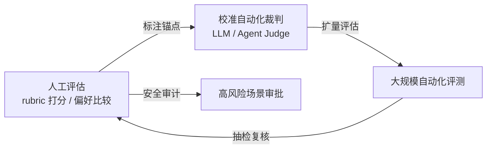

# 人工评估与裁判校准

## 定位与闭环

<b>图1 人工评估与自动化裁判的校准闭环</b>

## 核心结论

- 人工评估是**金标准**，但成本极高、不可扩展，因此它的定位不是主力评估手段，而是**可信度锚点**。
- 两个不可替代的用途：**裁判校准**（给 [[LLM-as-a-Judge]] / [[Agent-as-a-Judge]] 提供可信度参照）与**安全审计**（高风险场景的人工复核）。
- 与自动化裁判的关系是**闭环**而非替代：人工标注锚点 → 自动化扩量 → 抽检复核 → 反哺校准。

## 要点拆解

- **rubric 评分**：人工按评分细则逐项打分，比整体好坏判断更可复现，也更适合作为裁判提示词中的标准模板。
- **偏好比较**：人工在两份候选输出中择优，与 judge 的成对比较口径天然对齐，便于直接算一致性。
- **校准手段**：用人工标注集测裁判与人类的一致性（如超过 80% 的一致性水位）；用抽检复核发现裁判漂移；用人工只审高风险子集控制成本。
- **与线上闸门的分工**：人工评估发生在评估环节（离线或抽检），而 [[输出验证与人工审批]] 发生在输出出口（高风险动作的审批门），两者层级不同、可同时部署。

## 相关页面

- [[LLM-as-a-Judge]]：被校准的裁判范式
- [[LLM评委偏差与去偏差]]：人工锚例是通用兜底去偏手段之一
- [[置信度校准与ECE]]：自报概率与实际正确率的偏离度量
- [[Agent-as-a-Judge]]：以人工可靠性为基线参照的裁判范式
- [[四类评估方法对比]]：四类评估方法在成本与可靠性上的对比
- [[Agent评估组合策略]]：人工评估被安排在离线深度评估阶段
- [[输出验证与人工审批]]：人工在环的输出侧闸门
- [[意图评测]]：评测集构建与人工标注的方法论参照

## 参考来源

- [[raw/papers/Agent轨迹评估和结果评估.md]]
