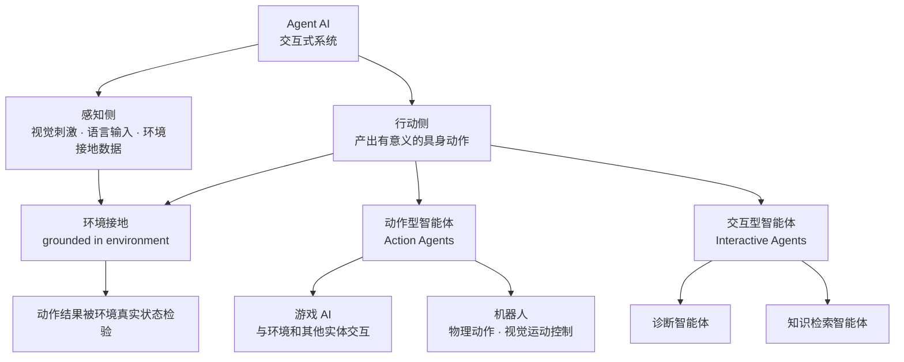

# 具身Agent与环境接地

## 核心结论

Agent AI 的定义不是「会调用工具的模型」，而是**一类交互式系统：能感知视觉刺激、语言输入和其他环境接地数据，并能产出有意义的具身动作**。判据落在**动作的落点**上——动作影响的是环境（物理或虚拟），而不是一次 API 调用。

一句话区分：软件工具型 Agent 的动作是「调用」，具身 Agent 的动作是「改变世界状态」；前者错在参数，后者错在状态。

## 要点拆解

### 从多模态智能体到具身智能体的四层谱系

谱系的关键不是名词多，而是每一层都在**收紧动作的定义**：

| 层级 | 定义 | 动作落点 |
|---|---|---|
| 多模态智能体（MAA） | 基于对多模态感知输入的理解，在给定环境中生成有效动作 | 环境 |
| 具身智能体（Embodied Agents） | 以机器人等形态、通过学习创造性地解决需要与环境交互的挑战性任务 | 物理环境 |
| 动作型智能体（Action Agents） | 需在模拟或真实世界中执行物理动作、主动与环境互动 | 物理动作 |
| 交互型智能体（Interactive Agents） | 更宽的类，不必然需要物理动作，可以是传递信息或修改环境 | 信息或环境 |

**动作型是交互型的子集，具身是动作型的常见形态，多模态是全部的前提。** 四层不是并列的分类，而是逐层收紧的包含关系——这一点在论文的分类体系里容易读反。

### 环境接地到底「接地」在哪

「接地」不是「接了个数据库」，而是**动作的结果会被环境的真实状态当场证伪**。论文的主张是：把智能体放进接地环境里训练，可以缓解大模型把内部知识当成世界状态的倾向——这条推论单独展开在 [[环境接地式幻觉治理]]。

接地的三个具体来源：
- **多感官输入**：视觉、语言、音频，以及环境中隐含的状态；
- **外部知识**：检索式补充，弥补参数里的知识截止；
- **人类反馈**：人对动作结果的评判，是环境反馈之外的第二条信号。

**三者共同构成「下一具身动作预测」的训练信号**，这是 [[AgentToken与下一动作预测]] 的输入侧。

### 动作型与交互型的工程含义不同

| 维度 | 动作型智能体 | 交互型智能体 |
|---|---|---|
| 动作形态 | 手柄输入、关节轨迹、抓取位姿 | 对话、信息组织、环境参数修改 |
| 反馈延迟 | 即时到数百毫秒，闭环要求高 | 秒级到分钟级，可容忍异步 |
| 失败代价 | 物理不可逆（碰撞、损坏） | 可撤销（说错话可纠正） |
| 主要难点 | 动作空间连续、状态估计不准 | 意图理解与知识准确性 |

这条二分对工程选型的直接价值是：**动作型的护栏要做在执行前（预校验、限位、急停），交互型的护栏要做在执行后（引用溯源、审核）**。前者参考 [[Agent最小权利与审批门]] 的预执行校验思路，后者参考 [[幻觉三层治理框架]] 的系统层兜底。

### 与工具型 Agent 的关系

[[Agent循环]] 记录的 Anthropic 定义「LLMs autonomously using tools in a loop」是**软件运行时视角**：循环、工具、上下文。具身视角补上的是**训练与动作表示视角**：动作空间怎么进模型、环境反馈怎么变成监督信号。两者不冲突，是同一个词在两个层面的展开——把工具换成动作空间，把工具返回换成环境状态。

差别在于抽象层级，可对照 [[Function Tool设计规范]]：工具是「已有能力的标准化封装」，agent token 是「原本无法用自然语言表述的动作的原生建模」。

## 相关页面

- [[AgentToken与下一动作预测]]：动作是怎么被建模进模型的，本页的行动侧展开。
- [[环境接地式幻觉治理]]：环境接地为什么能抑制幻觉，本页「接地」的推论。
- [[AgentAI综述总览]]：本节所属的领域全景与论文骨架。
- [[Agent循环]]：软件运行时视角的 Agent 定义，与本页构成两层对照。
- [[Agent训练方法阶梯]]：具身能力从哪来——训练路径的另一侧。

## 参考来源

- 线上原文：[https://arxiv.org/abs/2401.03568](https://arxiv.org/abs/2401.03568)（§1.3 定义、§5.1-§5.4 分类学）
- 本地备份：[[raw/papers/Agent-AI-Surveying-the-Horizons-of-Multimodal-Interaction.pdf]]