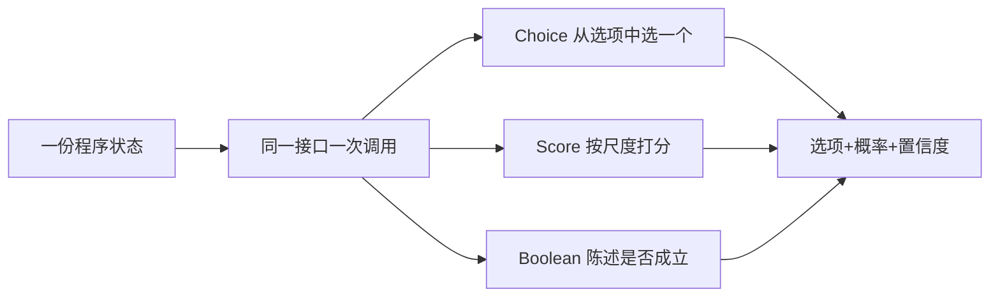

# 决策原语

## 定义

**决策原语**是 System One 模型对「机器判断」的**最小原子化抽象**，Jev 提供三种可通过同一接口混用的问题原语。

## 三种原语

| 原语 | 回答什么 | 返回内容 |
|---|---|---|
| **Choice** | 从若干选项中选一个 | 选项、各选项概率、置信度 |
| **Score** | 在某个评分尺度上打分 | 分值、概率分布、置信度 |
| **Boolean (Noul)** | 一句陈述是否成立 | 0~1 的概率 |

- **可混用**：一次调用中多个不同类型问题共享一份输入、独立并行评估。见 [[并行采样机制]]。
- 每个决策带置信度。见 [[校准置信度]]。

## 相关导航

- 模型：[[Jev 决策模型]]
- 品类：[[System One 模型]]
- 原理：[[类型化输出]]、[[并行采样机制]]、[[校准置信度]]
- 总览：[[Jev 决策模型总览]]

