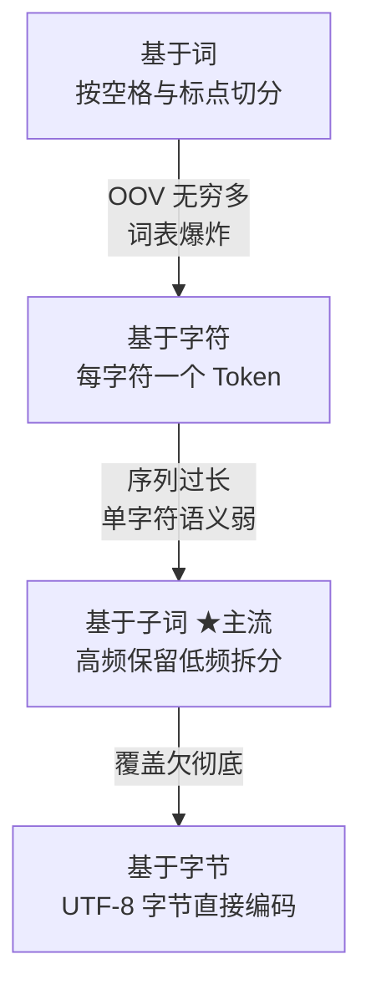

# 分词路线演进

## 核心结论

分词算法的演进是一条清晰的权衡链：基于词输给词表爆炸，基于字符输给序列长度，于是子词方案登场并成为主流；基于字节则是子词逻辑推到底的形态，代价是把组合的学习负担转移给了模型内部 [[1]](#ref-1)。整个演进史都在词表大小与序列长度两个约束之间找平衡。

图 1 分词四路线的演进与失位推力

## 要点拆解

### 四路线对照

| 路线 | 做法 | 优点 | 致命伤 |
|---|---|---|---|
| 基于词 | 按空格与标点切分 | 直观、语义完整 | OOV 无穷多、词表爆炸、处理不了形态变化 |
| 基于字符 | 每字符一个 Token | 无 OOV、词表极小 | 序列过长、单字符语义太弱 |
| 基于子词 | 高频词保留，低频词拆分 | 词表与序列长度双赢 | 算法较复杂，成为主流方案 |
| 基于字节 | UTF-8 字节直接编码 | 任意输入均可表示，彻底消灭 UNK | 序列更长，需要模型自己学组合 |

### 演进的动力

- **词 → 字符**：词表里永远装不下所有词，OOV 问题无解，且无法处理英语等语言的形态变化；
- **字符 → 子词**：单字符语义太弱、序列被拉长，于是保留高频整词、拆开低频词，让常见语义拿到完整 Token、罕见组合用碎片拼装；
- **子词 → 字节**：放弃词表对输入的覆盖承诺，任何输入都能编码，把组合的学习负担交给模型 [[1]](#ref-1)。

### 分词存在的根本原因

神经网络只能做数值计算，文本必须先变成向量序列，分词是离散符号到连续嵌入向量的桥梁；同时它是折中装置，词表开太大会显著增大嵌入矩阵参数，切得太碎又拉长序列增加计算。

## 相关页面

- [[BPE分词算法]]：子词路线的主流代表，高频相邻对迭代合并。
- [[WordPiece分词算法]]、[[Unigram分词算法]]：子词路线的另外两种合并准则。
- [[Tokenizer分词编码]]：分词在推理流水线中的整体位置。
- [[词表大小权衡]]：演进反复权衡的核心变量。
- [[主流分词方案对比]]：四路线下落成具体方案的横向对照。
- [[Token分词·素材摘要]]：本页所在素材全篇索引。

## 参考来源

[[raw/papers/Token分词.md]]
