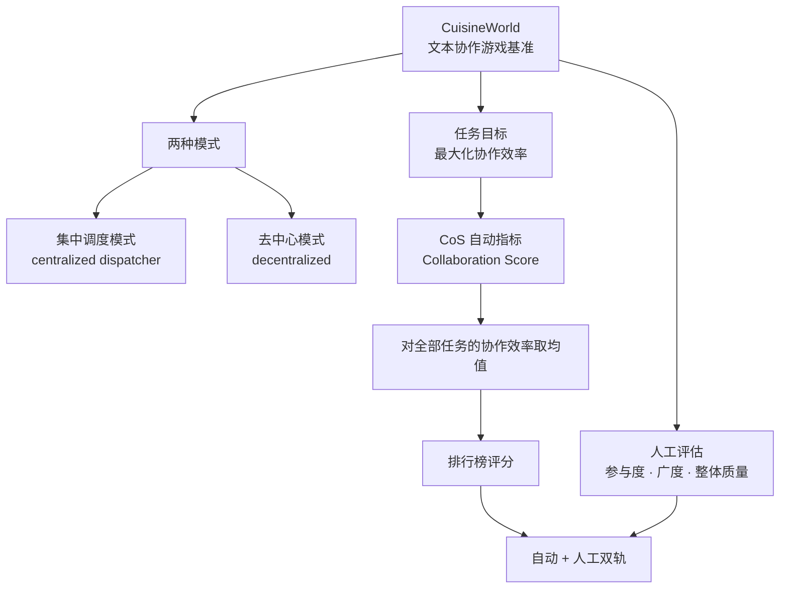

# 协作效率指标CoS

## 核心结论

多智能体系统长期缺一把标尺：**能测「任务完成没有」，测不了「配合得好不好」**。CoS 就是对这一空白的回应——一个**可自动计算的协作效率分**，在 CuisineWorld 这个文本协作任务集上，把「多智能体协作策略好不好」变成可排名、可回归的数字。

它的价值不在分数本身，而在**把协作质量从定性描述变成可比指标**。

## 要点拆解

### CuisineWorld 是什么

一个文本类协作游戏基准，风格接近 Overcooked!（多人分工煮菜）：AI 智能体需协作完成烹饪任务。设计目标明确指向两件事——**智能体是否理解目标**，以及**智能体之间能否相互协调**。

两种可选模式：

| 模式 | 控制结构 | 对应的架构问题 |
|---|---|---|
| 集中调度模式 | 有个中心调度者分配任务 | 对应 orchestrator/supervisor 拓扑 |
| 去中心模式 | 各智能体自主协商 | 对应 peer 拓扑 |

**同一套任务、两种拓扑可比**，这是该基准最实用的设计：它把「集中式还是去中心式」这个架构选择题变成了可实验的问题，而不是靠主观判断。

### CoS 的计算口径

官方口径很简洁，但要点必须读准：

- CoS 在多智能体系统的**全部任务上取协作效率的均值**作为最终评分；
- 属**自动指标**，来自 MindAgent 工作；
- 与**人工评估并行**：人工负责对单个回答评分，并对参与度、广度与用户交互整体质量给主观判断。

**自动分负责人与人之间的横向可比，人工分负责解释「为什么分低」。** 单看 CoS 排名会丢失失败原因，这与 [[大模型评测可信体系总览]] 里「同一分数在不同语境含义不同」的结论一致。

### 为什么这个指标值得借鉴

即使不做游戏，CoS 的思路可直接迁移到多 Agent 工程：

1. **它测的是协作而非产出**——避免「一个 Agent 把活全干了、其余空转」却拿高分的假象；
2. **它按任务均值聚合**——单任务波动被摊平，比单点分数稳健；
3. **它绑定了可复现的环境**——文本任务、可扩展任务定义文件、统一 API，评测可重跑。

**落地时的最小改造**：把「任务」换成你的真实业务流程，把「协作效率」定义成（必要交互次数 / 实际交互次数）或（有效信息传递 / 总消息量）这类可计算比值，就能得到自己业务的 CoS。

### 边界与风险

| 风险 | 说明 |
|---|---|
| 指标与真实业务目标不一致 | 游戏里协作效率高，不代表业务上成本低 |
| 集中/去中心不可混合评分 | 两种模式的 CoS 不在同一基线，跨模式排名无意义 |
| 自动指标可被优化钻空子 | 若把 CoS 当训练目标，智能体可能学会「看起来在协作」 |
| 人工评估不可省略 | 参与度与交互质量无法被 CoS 覆盖 |

最后一条与 [[人工评估与裁判校准]] 的原则一致：自动指标做门槛，人工作校准。

## 相关页面

- [[Agent训练方法阶梯]]：CoS 是训练之后的量化验收手段。
- [[多Agent上下文路由]]：多智能体的上下文传递机制，与本页的协作质量指标互补。
- [[Agent状态一致性]]：协作失败的另一类根因，CoS 只能暴露不能定位。
- [[大模型评测可信体系总览]]：自动指标 + 人工校准的评测可信框架。
- [[AgentAI综述总览]]：本节所属的论文骨架。

## 参考来源

- 线上原文：[https://arxiv.org/abs/2401.03568](https://arxiv.org/abs/2401.03568)（§9.1 CuisineWorld 数据集与 CoS 指标、§6.1.5 MindAgent 基础设施）
- 本地备份：[[raw/papers/Agent-AI-Surveying-the-Horizons-of-Multimodal-Interaction.pdf]]