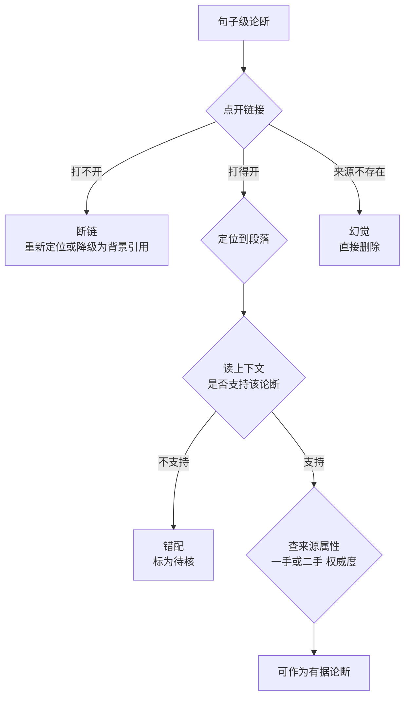

# 句子级引用归因

## 核心结论

报告带引用不等于可信。真正有价值的是**句子级引用**：每个论断可点回原始出处的具体段落，而非仅给出域名或首页链接。

三类归因失败必须分别识别与处置——它们的外表完全不同，混淆会导致错误的补救动作。

## 要点拆解

### 三类归因失败

| 失败类型 | 表现 | 特征 | 处置 |
|---|---|---|---|
| 错配 | 页面存在但不支持该论断 | 最难发现，链接点得开 | 读上下文后判定，标为待核 |
| 断链 | 链接失效或仅指首页 | 最常见 | 重新定位或降级为背景引用 |
| 幻觉 | 来源根本不存在 | 最危险 | 直接删除 |

错配之所以最难发现，是因为它通过了所有自动化检查：链接有效、页面存在、内容相关，只是不支持该句结论。这类只能靠人读上下文判定。

### 四步核对流程

人工核对一条引用可固化为四步，全过方可作为有据论断：

1. 点开链接
2. 定位段落
3. 读上下文确认支持关系
4. 查来源属性（一手或二手、权威度）

### 先追问再做研究

另一项易被忽略的设计是**先追问**：在开始研究前先提出澄清问题，把需求边界定清楚。官方将其作为产品决策对待，因其成本远低于事后返工。

这条对使用者同样成立——把问题边界交代清楚，比事后指出报告跑偏要省得多。

### 与幻觉治理的关系

引用幻觉是事实性幻觉在「带溯源输出」场景下的具体形态。通用的归因与检测方法参见 [[幻觉检测三条路径]] 与 [[可验证性四通道]]；本页关注的是引用这一特定载体的核对流程。

## 相关页面

- [[研究执行链路]]：引用在综合步骤中生成
- [[DeepResearch能力边界与风险]]：引用错配是三大风险之首
- [[幻觉检测三条路径]]：通用的检测手段
- [[RAG界面溯源设计]]：产品侧如何呈现溯源
- [[DeepResearch总览]]：领域入口页

## 参考来源

- [[raw/papers/Deep Research.md]]
