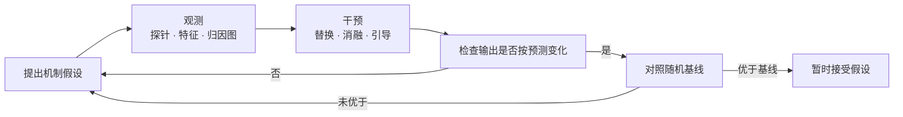

# 可解释性验证与局限

## 核心结论

单方法结论不足以采信，标准做法是 **观测 + 干预的闭环**：三种干预（激活替换、消融、引导）各有分工——替换定位关键位置，消融看性能掉多少，引导看行为是否可控；三者一致假设才成立。局限有三：覆盖与方法上限、解释与计算脱节、开放问题仍在。

## 要点拆解

### 验证闭环

图 1 观测与干预的验证闭环

随机基线用于排除「解释是解释器造出来的」[[11]](#ref-11)。其余层的验证：输出层把自述与扰动交叉比对（见 [[忠实性]]、[[行为层扰动]]）；过程层靠日志回放（见 [[过程审计]]）——这三层都不需要权重，可并进同一套发布前检查。

### 三类局限

| 局限 | 内容 | 出处 |
|---|---|---|
| 覆盖与方法上限 | SAE 有重建误差，部分信息没被任何特征解释；电路追踪替换保真度约五成，归因图必然漏边 | [[6]](#ref-6) |
| 解释与计算脱节 | 自动解释由另一模型生成，流畅度与机制正确性无关，随机模型也能得高分 [[11]](#ref-11)；人工判读有确认偏误（「金门大桥」特征 [[3]](#ref-3) 名字越具体越容易引人信整套结论） |
| 开放问题仍在 | 方法概念改进、对齐具体目标、研究与部署的社会技术挑战 [[15]](#ref-15)，任何「已解释」结论都带时效性【推导】 |

这不是调参能补的，属于方法上限【推导】。

## 相关页面

- [[大模型可解释性]]：验证与局限所属的上位概念。
- [[稀疏自编码]]、[[电路追踪]]：两条被点出上限的机制层方法。
- [[忠实性]]：输出层验证的交叉比对两端。
- [[可解释性落地选型]]：把验证清单变成发布前检查。

## 参考来源

[[raw/papers/大模型可解释性.md]]
