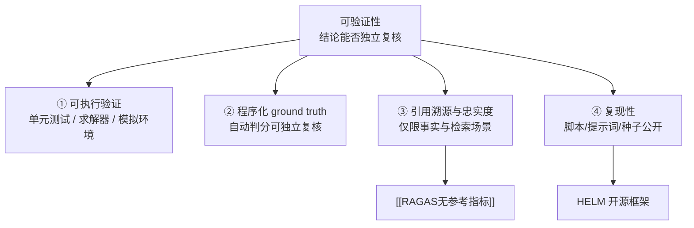

# 可验证性四通道

## 四通道结构

<b>图1 可验证性四条通道</b>

## 核心结论

- **证据可信不等于引用数量**，其完整形态是**可验证性**：结论能不能被第三方独立复核[[大模型评测可信·素材摘要]]。
- 四条通道各有适用域：**可执行验证**绕开主观评委，是最硬的一条；**程序化 ground truth** 让答案对错可独立复核；**引用溯源与忠实度**只服务事实与检索场景；**复现性**保证整个评测过程可重跑。
- 四通道的共同目标是把「相信我」变成「自己验」—— 与 [[独立验证机制]] 强调的「不要相信 Agent 的自述，要看客观证据」是同一原则在评测侧的表述。

## 要点拆解

| 通道 | 做法 | 适用与边界 |
|---|---|---|
| 可执行验证 | 代码跑单元测试、数学调用求解器、任务用模拟环境判分 | 通用，是最优先手段；不适用于纯开放文本质量判断 |
| 程序化 ground truth | 题库自带客观答案，由代码自动判分（代表性实现见[[LiveBench]]） | 需要可枚举的正确答案 |
| 引用溯源与忠实度 | 衡量回答是否被检索上下文支撑，实现见[[RAGAS无参考指标]] | **不适用数学与代码任务**，此类应改走可执行验证 |
| 复现性 | 评测脚本、提示词与随机种子公开，第三方可独立重跑 | 依赖 HELM 这类开源框架与规范披露 |

- **优先级**：能执行验证的优先执行验证；只能语义判断的才退回裁判，且裁判须经 [[人工评估与裁判校准]] 校准；两者的边界见 [[四类评估方法对比]]。
- **与 Agent 评估的衔接**：[[结果评估]] 的终态可验证性正是本四通道中「可执行验证 + 程序化 ground truth」的组合；[[RAG界面溯源设计]] 是「引用溯源」在产品界面上的落地形态。
- **常见误区**：把「附了参考文献链接」当作证据可信 —— 若回答并未被所引上下文支撑，引用数量再多也不构成证据。

## 相关页面

- [[RAGAS无参考指标]]：引用溯源与忠实度的指标实现
- [[LiveBench]]：程序化 ground truth 的代表基准
- [[独立验证机制]]：同一原则在 Agent 生产落地中的表述
- [[结果评估]]：终态可验证是结果评估的前提
- [[RAG界面溯源设计]]：引用溯源在界面层的落地
- [[大模型评测可信体系总览]]：证据可信支线在四支柱中的位置
- [[大模型评测可信·素材摘要]]：素材出处

## 参考来源

- [[raw/papers/大模型评测可信.md]]
