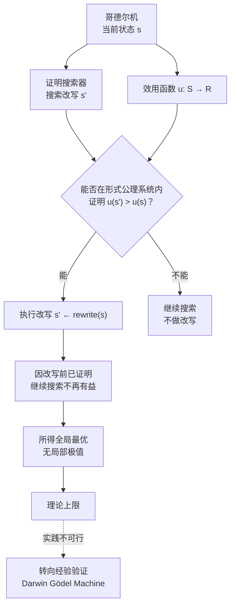

# 哥德尔机

## 核心结论

哥德尔机给了 RSI 一个**理论上限**，但不是一个可运行方案。

它的形式简洁到一句话：**只有当能在形式公理系统内证明「改写后的效用严格更优」时，才执行改写**：

$$s' \leftarrow \text{rewrite}(s) \iff \exists \text{proof}: u(s') > u(s)$$

这个设计保证了改写的**全局最优性**（因为改写前必须先证明「继续搜索不再有益」，所以不存在被错过的更优状态）。代价是：实践中「证明大多数改写净有益」不可行，因此工程路线转向用经验验证替代形式证明。

## 要点拆解

### 三个组件

| 组件 | 作用 | 关键约束 |
|---|---|---|
| 证明搜索器 | 在形式系统内搜索改写有益性的证明 | 只在可形式化的性质上有效 |
| 效用函数 $u:\mathcal{S}\to\mathbb{R}$ | 给每个自身状态打分 | 必须能被形式化表达 |
| 改写操作 $\text{rewrite}$ | 修改自身代码 | 改写本身也在被证明的范围内 |

**自指结构是它的本质**：改写器、证明器、效用函数都是系统自身的一部分，因此「改自己」与「证明自己该被改」是同一个动作。

### 全局最优为什么成立

关键在于「改写前须先证明继续搜索不再有益」。这条协议让每一步改写都是**在完整搜索空间上可证明的最优动作**，而不是贪心选择。

因此结论是：**所得改写全局最优、无局部极值**。

对比经验路线（如下文的 DGM），后者只能保证「局部探索找到更好」，无法排除错过的更优解——这正是理论框架与工程方案的分野。

### 为什么实践中不可行

| 障碍 | 说明 |
|---|---|
| 形式化范围有限 | 大量工程上有益的改写难以在公理系统内形式化证明其净收益 |
| 证明成本爆炸 | 证明搜索本身可能比改写更贵 |
| 效用函数难定义 | 「什么算更优」在开放任务上难以写成可证明的表达式 |

结论落在素材那句话上：**实践中「证明大多数改写净有益」不可行，遂转向以经验验证替代形式证明的工程路线。**

### 向工程路线的转向：DGM

达尔文哥德尔机（Darwin Gödel Machine, DGM）是这个转向的代表实现。它把「证明」松绑成「基准验证」：

| 环节 | 哥德尔机 | DGM |
|---|---|---|
| 改写依据 | 形式证明 | 基准测试经验验证 |
| 搜索方式 | 证明搜索 | 开放式存档 + 采样代理树，并行探索多条路径 |
| 最优性 | 全局最优 | 局部探索，无最优性保证 |
| 可运行性 | 理论 | 实际可跑 |

DGM 用 SWE-bench 等编程基准对每次改写做经验验证，并维护由生成代理构成的开放式存档，采样生成多样化的代理树。落地的四件套是：基准门槛设通过阈值达标才合并、回归保护用沙盒跑既有测试防止回退、多评估器交叉（正确率/崩溃率/耗时互证防刷分）、版本化存档加可回退快照。

这四件套的本质是**用工程冗余弥补理论保证的缺失**——既然无法证明改写一定更好，就用多重验证与可回滚来限制坏的改写造成的影响。

## 相关页面

- [[递归自我改进RSI]]：哥德尔机所形式化的对象定义。
- [[RSI四项判定标准]]：哥德尔机满足自主闭环与持久性，但稳健性依赖形式系统外的保障。
- [[有界RSI与开放式RSI]]：DGM 属有界 RSI，哥德尔机代表理论上限。
- [[点火条件与复利因子G]]：回答「即便能改写，改进会不会复利」。
- [[递归自我改进总览]]：本页所属的领域全景。

## 参考来源

- 线上原文：[https://arxiv.org/abs/cs/0309048](https://arxiv.org/abs/cs/0309048)（Schmidhuber 2003, Gödel Machines）
- 线上原文：[https://arxiv.org/abs/2505.22954](https://arxiv.org/abs/2505.22954)（Zhang et al., Darwin Gödel Machine）
- [[raw/papers/RSI递归自我改进.md]]（§3.1 哥德尔机的理论形式化、§3.2 递归闭环的工程化路径）
