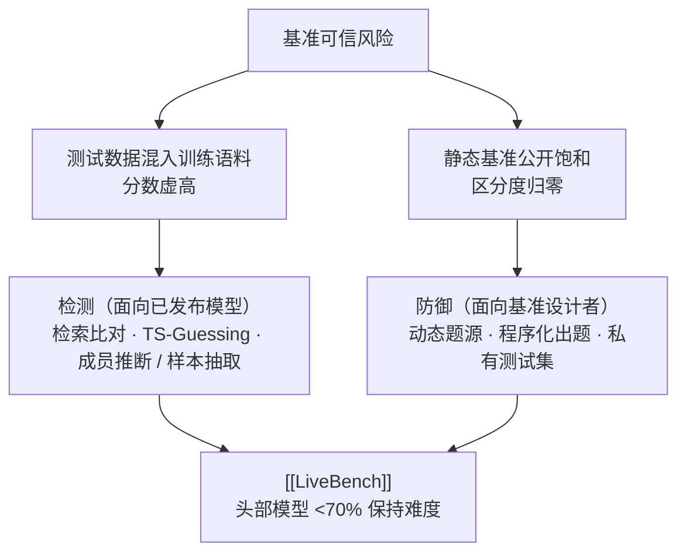

# 基准污染与动态基准

## 机制与两条应对路线

<b>图1 基准污染的风险、检测与防御</b>

## 核心结论

- **测试数据混入训练集是公平评测的公认障碍**，会迅速使基准过时；公开基准还会随模型能力提升而饱和，头部模型分数趋同后区分度归零[[大模型评测可信·素材摘要]]。
- 实证证据有三层：模型在训练截点前发布的数据集上表现显著优于其后发布者（时间序证据）、训练数据检查与样本抽取/成员推断（直接证据）、无污染可能的分类任务上模型相对多数类基线鲜有统计显著提升（反证）。
- **检测与防御面向不同对象**：检测面向已发布模型（审计已有分数可不可信），防御面向基准设计者（设计新基准时就把污染挡在门外），不能相互替代。

## 要点拆解

| 手段 | 原理 | 适用对象 |
|---|---|---|
| 检索比对 | 在预训练语料中检索与测试题的重叠片段 | 开源模型与已知语料 |
| [[TS-Guessing污染检测]] | 遮蔽多选题中的错误选项要求补全，命中率异常即为污染证据 | 开源与闭源模型均可 |
| 成员推断 / 样本抽取 | 判断训练集是否含有该样本、或能否从模型反推出训练样例 | 可复现的模型与数据集 |
| 动态题源 | 基于近期新闻、竞赛、arXiv 论文等来源定期更新题目 | 任何模型 |
| 程序化出题 | 由规则或代码生成可验证答案的新题 | 任何模型 |
| 私有测试集 | 不公开评测集或延迟公开 | 闭源评测场景 |

- [[LiveBench]] 是防御侧代表：题源取自近期数学竞赛、arXiv 论文、新闻与数据集，按客观 ground truth 自动打分，同时规避测试集污染与 LLM 评委、人工众包的偏差。
- 污染与 [[结果评估]] 的关系：结果评估要求终态可机器验证，而污染正是让「验证通过」失去意义的头号干扰项；持续回归场景下需配合 [[持续评估]] 的题库轮换策略。

## 相关页面

- [[TS-Guessing污染检测]]：黑盒可用的污染检测手段
- [[LiveBench]]：动态题源 + 客观判分的抗污染基准
- [[大模型评测可信体系总览]]：四支柱总览中的基准可信支线
- [[结果评估]]：终态可验证是结果评估的前提，污染直接破坏该前提
- [[持续评估]]：CI 中的 eval 套件同样面临题目泄漏与固化失效
- [[大模型评测可信·素材摘要]]：素材出处

## 参考来源

- [[raw/papers/大模型评测可信.md]]
