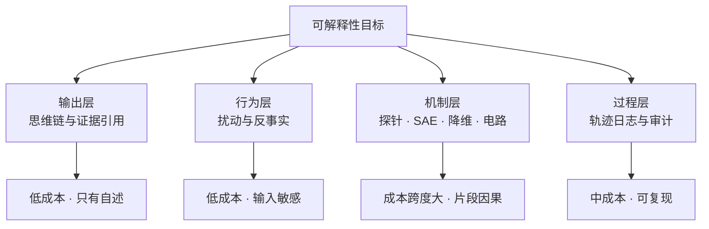

# 大模型可解释性

## 核心结论

可解释性（interpretability）指用人类可理解的方式说明模型为何产生某个输出，且说明经得起检验——它与「模型自己说了什么理由」的本质区别在忠实性：后者只要文本通顺，前者要求与真实计算过程一致 [[1]](#ref-1)。当下主流手段几乎全是事后解释（post-hoc）；按介入方式分四层，成本与能力差异巨大。四层共享一条底线：**观测只给相关性，因果只能靠干预**。

图 1 可解释性四层谱系

## 要点拆解

### 与近邻概念的分工

| 概念 | 关心的问题 | 评价标准 |
|---|---|---|
| 可解释性 | 为什么是这个输出 | 说明忠实、完整 |
| 可监控性（monitorability） | 能不能及时发现异常 | 漏报率，允许解释不完整 |
| 可控制性（steerability） | 能不能按需改变行为 | 干预效果与副作用 |

工程分工：合规审计取可解释性，安全运营取可监控性，产品调优取可控制性【推导】。最常见的误配是把可解释性当成安全方案的全部。

### 观测与干预的分层

- **输出层**：让模型先写推理再给结论，或给证据挂可点回的原文，最便宜但可能不忠实（见 [[忠实性]]）；
- **行为层**：只改输入看输出变化，见 [[行为层扰动]]；
- **机制层**：拆权重找特征与电路，粒度递进为探针读单点 → SAE 读原子 → 降维读几何 → 电路读连接，见 [[线性探针]]、[[稀疏自编码]]、[[降维与激活引导]]、[[电路追踪]]；
- **过程层**：Agent 多步任务的事后决策链复现，最容易被低估却最该先做，见 [[过程审计]]。

机制层最激进的一支（mechanistic interpretability）要把网络拆成可命名的特征与电路，回答「哪几步计算导致了这次输出」[[2]](#ref-2)；其根本瓶颈是叠加与多义，见 [[叠加与多义]]。

## 相关页面

- [[忠实性]]：所有解释都必须先过的性质关卡。
- [[行为层扰动]]、[[过程审计]]：免权重两层的原理页。
- [[线性探针]]、[[稀疏自编码]]、[[降维与激活引导]]、[[电路追踪]]、[[叠加与多义]]：机制层族页。
- [[可解释性落地选型]]：按投入产出的三级排序与反模式。
- [[可解释性方法对比]]：七类手段横向总表。
- [[Agent可观测追踪三轴]]：过程层与 Agent 可观测性的衔接。
- [[大模型可解释性·素材摘要]]：本素材全篇要点索引。

## 参考来源

[[raw/papers/大模型可解释性.md]]
