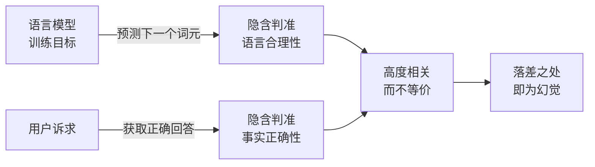

# 大模型幻觉定义与本质

## 核心结论

语言模型的训练目标是预测下一个词元、隐含判准为语言合理性，而用户的真实诉求是获取正确回答、判准为事实正确性，**二者高度相关而不等价，落差之处即为幻觉**。

形式化地，给定输入 $x$ 与候选输出 $y$，模型按条件概率 $P_\theta(y\mid x)$ 选优，而概率最高并不等于为真。引入记号（非引自文献）：

$$\text{Hallucination}(x,y) \iff y=\arg\max_{y'} P_\theta(y'\mid x)\ \wedge\ \neg\,\mathrm{True}(y,x)$$

关键在于：**模型内部没有任何模块计算 $\mathrm{True}(\cdot)$**。它输出的是「自身分布里最像正确答案的序列」，而这个分布完全由语料写成。

## 要点拆解

### 一句话定义

综述将其概括为：**流畅、语法正确、但事实不准确或缺乏外部证据支撑的内容生成**。

### 为什么它难以被发现

危害的根源在于幻觉的**表征与正确回答完全同构**——语气自信、格式规范、细节丰富，与真实回答在字面层面无法区分，用户难以凭表面判断真伪。

这是它区别于普通程序 bug 的关键：程序 bug 会抛异常、会返回错误码，而幻觉会「看起来很对」。

### 与温度的衔接

既然根因在分布而非采样，调温度就无法根治。这一推断由 [[温度归零不消除系统性幻觉]] 给出完整论证。

## 相关页面

- [[事实性幻觉与忠实性幻觉]]：按「和谁比错了」对幻觉做的第一层切分。
- [[幻觉成因四条线]]：落差从哪来。
- [[温度归零不消除系统性幻觉]]：为什么调温度治不好。
- [[大模型幻觉技术全景总览]]：本页所属的领域全景。

## 参考来源

- [[raw/papers/大模型幻觉成因与分层治理.md]]
