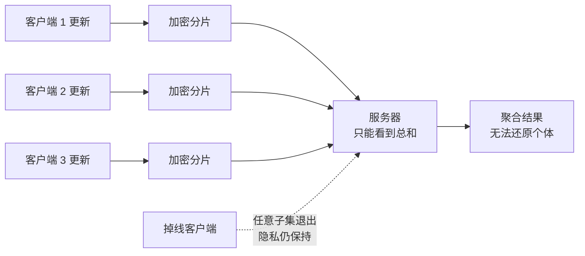

# 安全聚合SecAgg

## 核心结论

安全聚合（Secure Aggregation, SecAgg）解决的是**「服务器不可信」**这一威胁：服务器只能得到所有客户端更新之和，**无法查看任何单个客户端的更新**。

它把联邦学习的隐私信任边界从「相信服务方不看」改为「服务方看不到」，是联邦学习生产系统中最基础的密码学防护层。

## 要点拆解

### 安全模型与威胁假设

Bonawitz 等提出的多方协议在两种威胁模型下均有安全性证明：

| 威胁模型 | 服务器行为假设 |
|---|---|
| 诚实但好奇（honest-but-curious） | 遵守协议，但试图从收到的数据推断个体信息 |
| 恶意（malicious） | 可任意偏离协议 |

**关键能力是掉线容忍**：即使任意选择的客户端子集在任意时刻退出，隐私仍被保持。这一点对跨设备场景至关重要——移动设备随时可能离线。

### 通信开销

实测数据（16 位输入值）：

| 用户数 | 向量维度 | 通信膨胀倍数 |
|---|---|---|
| $2^{10}$ | $2^{20}$ | 1.73× |
| $2^{14}$ | $2^{24}$ | 1.98× |

即使在大规模客户端池上，运行时与通信开销依然较低——这是它能进入生产流水线的前提。

### 与另两层防护的分工

安全聚合只是三道防线之一，三者解决不同问题：

| 机制 | 解决的问题 | 局限 |
|---|---|---|
| 安全聚合 | 服务器不可信 | 聚合结果本身仍可能被推断 |
| [[差分隐私]] | 输出可被推断 | 需信任加噪位置 |
| 可信执行环境 | 隐私不可验证 | 引入硬件漏洞假设与开销 |

因此三者是互补而非替代关系，详见 [[联邦学习总览]]。

### 边界

- 安全聚合保证「服务器看不到个体更新」，但**不保证聚合结果不泄露信息**——成员推断与模型反演仍可能奏效，需叠加差分隐私。
- 掉线容忍会增加协议轮次；客户端规模极大时通信与协调成本上升。

## 相关页面

- [[联邦学习]]：本页所属的范式定义。
- [[差分隐私]]：解决「输出可被推断」的第二道防线。
- [[梯度泄露攻击]]：为什么需要这道防线。
- [[FedAvg联邦平均]]：安全聚合服务的聚合算法。
- [[联邦学习总览]]：三道防线的整体位置。

## 参考来源

- [[raw/papers/联邦学习.md]]（§3.4 三道防线）
- 线上原文：[https://eprint.iacr.org/2017/281](https://eprint.iacr.org/2017/281)（Bonawitz 等，ACM CCS 2017）
