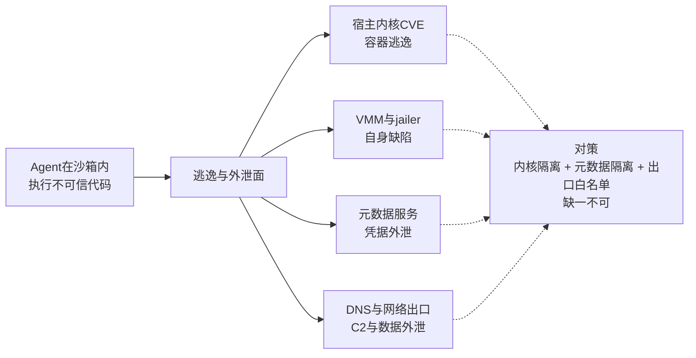

# 容器逃逸与沙箱绕过

## 核心结论

容器共享宿主内核，**这决定了它的安全天花板**：内核一个提权漏洞即可导致容器逃逸，并波及同宿主的其他容器。结论是——

> **「任意不可信代码 + 多租户」场景下，容器已知不充分。**

这也解释了为什么以容器换冷启动速度的平台，仍会额外提供 gVisor 一类的加固选项。

## 要点拆解

### 三组代表性 CVE

- **CVE-2019-5736**：runc 缺陷可覆写宿主二进制并取得 root 权限；
- **CVE-2024-21626（Leaky Vessels）**：文件描述符泄漏使容器内进程可访问完整宿主文件系统；
- **CVE-2025-31133 / CVE-2025-52565 / CVE-2025-52881**：mount 处理缺陷可绕过 AppArmor 与 SELinux。

### 内核之外还有三条绕过路径

- **DNS 通道外泄**：AWS Bedrock AgentCore 的 Code Interpreter 被发现可通过 DNS A/AAAA 记录外泄数据、建立双向 C2 通道，CVSS 评分 7.5，与其「完全隔离」的宣传口径相悖；
- **元数据服务**：microVM 的元数据接口可被用来窃取宿主凭据；
- **VMM 与 jailer 自身缺陷**：如 jailer 符号链接导致覆写宿主文件的漏洞。

这四类面（含内核 CVE）合起来构成图中四条分支，**对策缺一不可**——这正是 [[Firecracker微虚拟机]] 中「hypervisor 隔离是必要而非充分条件」的原因。

### 两条共性教训

1. **数据外泄几乎都走网络**，沙箱的网络访问控制与内核隔离同等重要——只做计算隔离不做出口白名单，等于留了一条免费信道；
2. **沙箱是概率性降低损失，不是绝对保证**。Firecracker 无已知逃逸 CVE 不代表不可能，Seatbelt 的 profile 易写错，域名白名单也可能被 domain fronting 一类技巧绕过。

第 1 条是 [[OS原语沙箱机制]] 中「OS 原语管文件 + 用户态代理管网络」混合架构的直接动因；第 2 条是 [[沙箱选型权衡与落地避坑]] 的核心立场。

## 相关页面

- [[gVisor用户态内核]]：共享内核天花板下的一种加固路线。
- [[OS原语沙箱机制]]：网络出口白名单这一侧的实现。
- [[沙箱四层技术栈]]：把内核隔离、元数据隔离、出口白名单分层落进企业底座。
- [[LLM-Agent安全防护总览]]：沙箱逃逸与提示词注入分属执行层与输入层两类风险。
- [[Agent沙箱技术全景总览]]：本页所属的领域全景。

## 参考来源

- [[raw/papers/Agent沙箱.md]]
