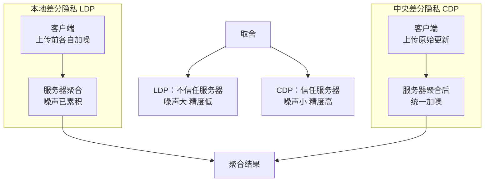

# 差分隐私

## 核心结论

差分隐私（Differential Privacy, DP）解决的是**「输出可被推断」**：通过向聚合结果注入经过校准的随机噪声，使单个样本的存在与否在统计上不可分辨。

在联邦学习中，它补上 [[安全聚合SecAgg]] 留下的缺口——安全聚合让服务器看不到个体更新，但聚合结果本身仍可能被反推出信息。

## 要点拆解

### 两种部署位置

联邦学习中的差分隐私按**加噪位置**分为两类，本质是信任假设与精度代价的权衡：

| 类型 | 加噪位置 | 信任假设 | 精度代价 |
|---|---|---|---|
| 中央差分隐私（CDP） | 服务器聚合后统一加噪 | 需信任服务器 | 噪声小，精度损失小 |
| 本地差分隐私（LDP） | 每个客户端上传前各自加噪 | 不信任服务器 | 噪声累积大，精度损失明显 |

**这是一条没有免费午餐的取舍**：想要更少的精度损失，就得信任服务器；想要零信任，就得接受明显的模型质量下降。

### 客户端级视角

联邦学习中的隐私保护通常按**客户端粒度**而非样本粒度定义——即「某个客户端是否参与训练」不可分辨。Geyer 等给出的客户端级差分隐私方案是该方向的代表性工作。

实际部署中，加噪前通常要先做**梯度裁剪**（gradient clipping）以限定敏感度，否则单个客户端的更新可能对总和产生过大影响。

### 与另两层防护的分工

| 机制 | 解决的问题 |
|---|---|
| [[安全聚合SecAgg]] | 服务器不可信 |
| 差分隐私 | 输出可被推断 |
| 可信执行环境 | 隐私不可验证 |

三者互补，构成联邦学习的分层防护，详见 [[联邦学习总览]]。

### 边界

- 隐私预算（ε, δ）是有限资源，多轮训练会持续消耗，需跨轮次管理。
- 本地差分隐私在高维模型上的噪声累积会显著损害收敛质量，实践中更常用中央差分隐私或分布式 DP。
- 差分隐私不防「上传前就泄露」——客户端本地的数据安全仍需独立保障。

## 相关页面

- [[联邦学习]]：本页所属的范式定义。
- [[安全聚合SecAgg]]：第一道防线，与本页互补。
- [[梯度泄露攻击]]：本页要缓解的具体威胁。
- [[联邦学习总览]]：三道防线的整体位置。

## 参考来源

- [[raw/papers/联邦学习.md]]（§3.4 三道防线）
- 线上原文：[https://arxiv.org/abs/1712.07557](https://arxiv.org/abs/1712.07557)（Geyer 等，2017）
