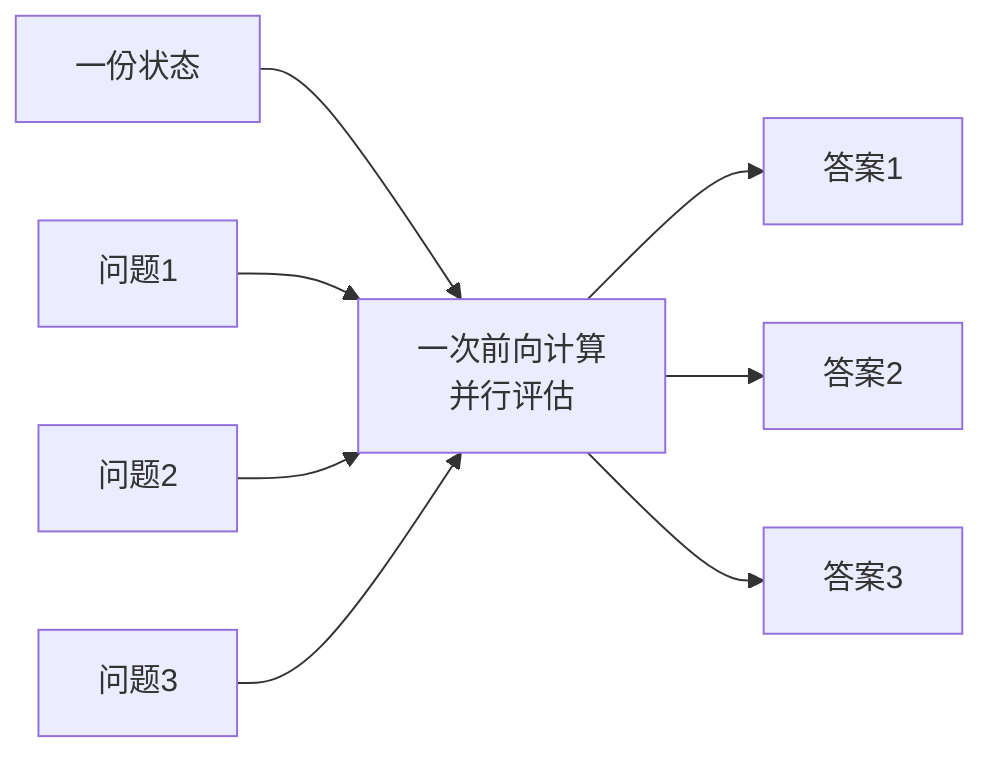

# 并行采样机制

## 定义

**并行采样**指 Jev 的所有答案在**一次前向计算中并行产生**，而非传统大模型逐 token 自回归地「往外蹦字」。

## 关键内涵

- 这是 Jev 做到**毫秒级响应（70~500ms）**的根本原因。
- 一次调用中，多个不同类型的问题**共享一份输入、独立并行评估**，可以混用。见 [[决策原语]]。
- 对比：传统 LLM 逐 token 生成自由文本，速度慢且输出结构不确定。见 [[Jev 与传统 LLM 对比]]。

## 相关导航

- 模型：[[Jev 决策模型]]
- 品类：[[System One 模型]]
- 原理：[[类型化输出]]、[[决策原语]]、[[校准置信度]]
- 总览：[[Jev 决策模型总览]]

