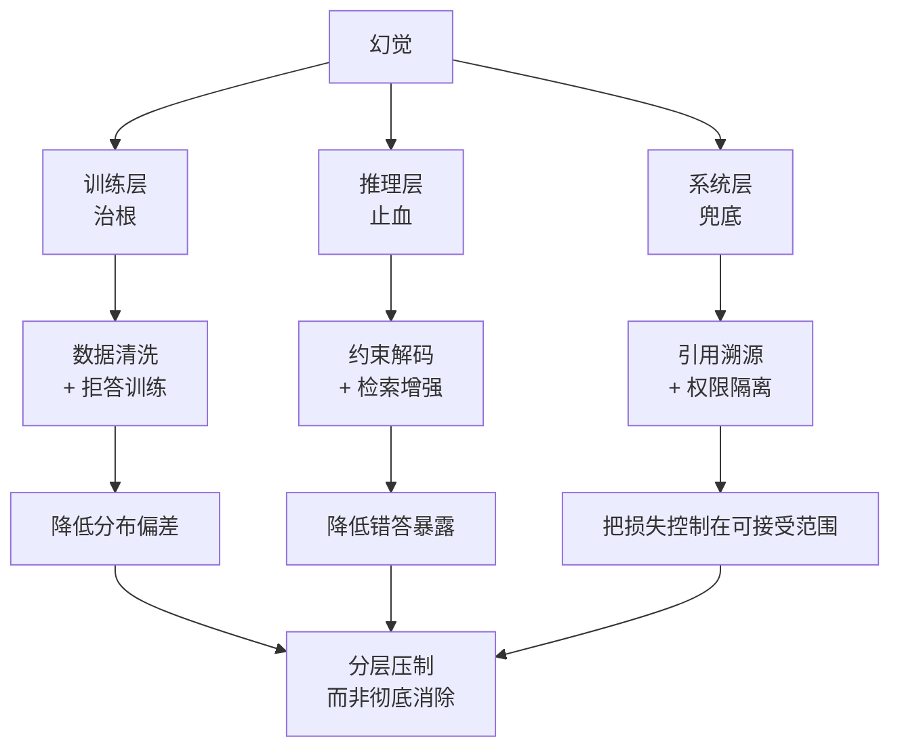

---
type: concept
source: "[[raw/papers/大模型幻觉成因与分层治理.md]]"
description: "训练层治根、推理层止血、系统层兜底的三层治理框架：训练层调数据与目标，推理层控解码与检索，系统层做权限与拒答；层间互补，层内手段各有边界，不存在单一银弹。"
created_at: 2026-10-11 23:12:03
updated_at: 2026-10-11 23:12:03
tags: [hallucination, mitigation, training, inference, system_layer, concept]
---

# 幻觉三层治理框架

## 核心结论

由于四条成因线分属不同环节，治理必须分层：

| 层 | 目标 | 主要手段 | 边界 |
|---|---|---|---|
| 训练层 | 治根 | 数据清洗、拒答训练、目标对齐 | 成本高、周期长 |
| 推理层 | 止血 | 约束解码、检索增强 | 只能压表征，改不了分布 |
| 系统层 | 兜底 | 引用溯源、权限隔离 | 降低损失，不消除根因 |

**层间互补，层内手段各有边界，不存在单一银弹。** 这是「分层压制而非彻底消除」这一治理目标的直接来源。

## 要点拆解

### 训练层：治根但最贵

数据侧清洗语料、平衡长尾，能直接降低 [[幻觉成因四条线]] 中的数据偏差与压缩失真；目标侧引入拒答训练，纠正 SFT 教出的「永远给像样答案」这一行为模式。

拒答训练是训练层里性价比最高的一项——它不新增知识，只是**给模型加上「不知道」这个合法选项**，详见 拒答训练。

代价是需要重训或继续预训练，周期以周月计，且有灾难性遗忘风险。

### 推理层：只切断通路，不改分布

约束解码限制输出格式与解码策略，检索增强把外部知识注入上下文。二者都作用在**生成环节**，不改变模型参数里的分布。

因此推理层只能**止血**：把已经在分布里偏掉的答案，通过外部约束压回去。这解释了为什么推理层手段在 [[幻觉归因提示词与模型分诊]] 里对「模型主导」型幻觉效果有限。

检索增强的边界与前置条件见 [[RAG幻觉治理边界]]。

### 系统层：降低损失，不是消除根因

引用溯源让每个论断可追溯到来源，权限隔离把模型的行动范围限制在可控域内。它们不试图让模型「说得更对」，而是**让模型说错时的代价可控**。

这一层与 [[LLM-Agent安全防护总览]] 的纵深防御思路同源：承认单点不可靠，用多层组合控制最终损失。

### 三层为什么不能互换

| 错配 | 后果 |
|---|---|
| 用系统层手段治根因 | 上线一堆过滤器，分布照旧偏 |
| 用训练层手段治表征 | 等几个月重训，问题却出在检索没做好 |
| 只上推理层不上系统层 | 一次检索失败直接穿透到用户 |

## 相关页面

- [[幻觉成因四条线]]：三层分配的依据。
- [[幻觉检测三条路径]]：治理前必须先测。
- [[大模型幻觉治理实践]]：六条工程避坑的落点。
- [[大模型幻觉技术全景总览]]：本页所属的领域全景。

## 参考来源

- [[raw/papers/大模型幻觉成因与分层治理.md]]
