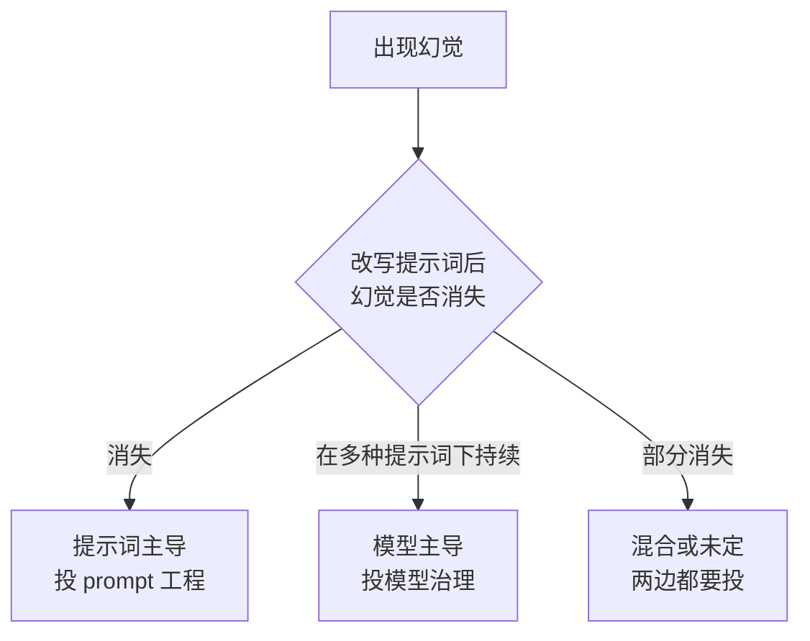

# 幻觉归因提示词与模型分诊

## 核心结论

治理前要先分诊。Anh-Hoang 等提出 Prompt Sensitivity 与 Model Variability 两个度量，把幻觉归因为**提示词主导、模型主导、混合或未定**四类，并给出可操作判据：

**若改写提示词后幻觉消失，多半是提示词问题；若在不同提示词下幻觉持续，则指向模型内部行为。**

这条分诊线决定了后续投入应放在 prompt 工程还是模型治理上。

## 要点拆解

### 为什么必须先归因

在 prompt 上反复调优却治不好分布偏差，是工程里最常见的浪费。归因错误的成本远高于归因本身：

| 归因 | 错误投入方向 | 典型症状 |
|---|---|---|
| 实为模型主导 | 在 prompt 上无限调参 | 换措辞有效一次，下次又复发 |
| 实为提示词主导 | 上线检索或微调 | 成本高但根因没动 |

### 实证侧的印证

受控提示词实验显示，结构化提示（如思维链）能显著降低提示词敏感场景下的幻觉，但**部分模型的内在局限在多种提示词变体下持续存在**——这正是「分布本身有偏」的表现，与 [[温度归零不消除系统性幻觉]] 的推断一致。

### 分诊之后

- 提示词主导 → 落到 [[大模型幻觉治理实践]] 的约束解码与指令遵循。
- 模型主导 → 落到 [[幻觉三层治理框架]] 的训练层与推理层。

## 相关页面

- [[大模型幻觉定义与本质]]：幻觉的根因本体。
- [[幻觉成因四条线]]：模型主导一侧的四条来源。
- [[温度归零不消除系统性幻觉]]：模型主导的机理证据。
- [[大模型幻觉治理实践]]：分诊结论的落地入口。

## 参考来源

- [[raw/papers/大模型幻觉成因与分层治理.md]]
