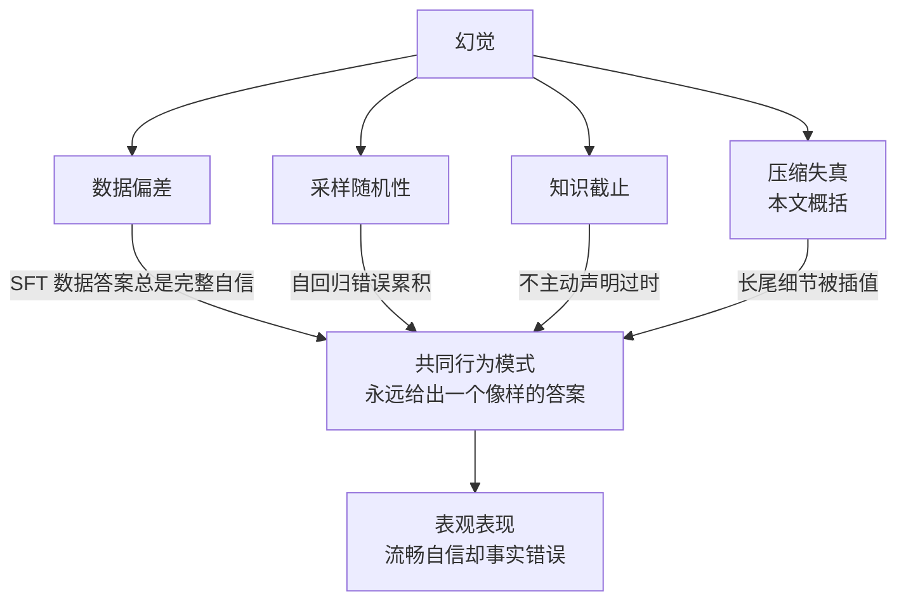

---
type: concept
source: "[[raw/papers/大模型幻觉成因与分层治理.md]]"
description: "综合综述对数据—架构—推理全生命周期的分析，把大模型幻觉成因归纳为四条工程可操作的线：数据偏差、采样随机性、知识截止、压缩失真；四条线分属不同环节，因此没有单一银弹。"
created_at: 2026-10-11 23:12:03
updated_at: 2026-10-11 23:12:03
tags: [hallucination, root_cause, data_bias, sampling, knowledge_cutoff, concept]
---

# 幻觉成因四条线

## 核心结论

综合综述对「数据—架构—推理」全生命周期的成因分析，可归纳为四条工程上可操作的成因线：

| 成因线 | 机制 | 主要落点 |
|---|---|---|
| 数据偏差 | 语料含错含谣含偏见；长尾稀疏；SFT 教出「永远给像样答案」 | 训练层 |
| 采样随机性 | 温度/top-p 把生成引向低概率分支；自回归错误累积 | 推理层解码 |
| 知识截止 | 语料有时间边界，边界后不主动声明过时 | 推理层检索 |
| 压缩失真 | 参数容量有限，长尾细节在压缩中丢失或模糊 | 训练层数据 |

**四条线分属不同环节，因此没有单一银弹**——这也直接决定了 [[幻觉三层治理框架]] 的分层结构。

## 要点拆解

### 数据偏差：最隐蔽的一层在指令微调

训练语料本身含错、含谣、含偏见；长尾领域数据稀疏，模型只能补白。更隐蔽的一层在指令微调：**SFT 数据里答案总是完整自信，模型学到的并非知识本身，而是「永远给出一个像样的答案」这一行为模式**。

这是 [[事实性幻觉与忠实性幻觉]] 中拒答训练的直接靶点——拒答训练正是对这一行为模式的正面纠正。

### 采样随机性：错误会顺着偏掉的上下文圆下去

解码时每个词元按概率分布抽样（温度、top-p），随机性会把生成引向低概率但表面连贯的分支；自回归结构使错误逐步累积，且模型倾向于顺着已经偏掉的上下文继续圆下去。

机制本体见 [[采样解码策略]] 与 [[自回归迭代与终止]]。

### 知识截止：不会主动说「我不知道」

训练语料有时间边界，边界之后的世界变化模型无从知晓，却**不会主动声明过时**，而是沿用旧分布补出一个貌似合理的答案。这是 [[RAG幻觉治理边界]] 中「RAG 补的是知识截止」的根因。

### 压缩失真：本文概括，非引自文献

参数容量有限，可视为对海量语料的有损压缩：高频知识压得准，长尾细节与精确数字在压缩中丢失或模糊，生成时被插值成近似但错误的内容，最终与数据偏差叠加，表现为长尾事实的系统性失真。

## 相关页面

- [[大模型幻觉定义与本质]]：四条线共同造成的目标错位。
- [[幻觉三层治理框架]]：按成因线分配治理层。
- [[幻觉归因提示词与模型分诊]]：四条线均属模型主导，是分诊的另一半。
- [[大模型幻觉技术全景总览]]：本页所属的领域全景。

## 参考来源

- [[raw/papers/大模型幻觉成因与分层治理.md]]
