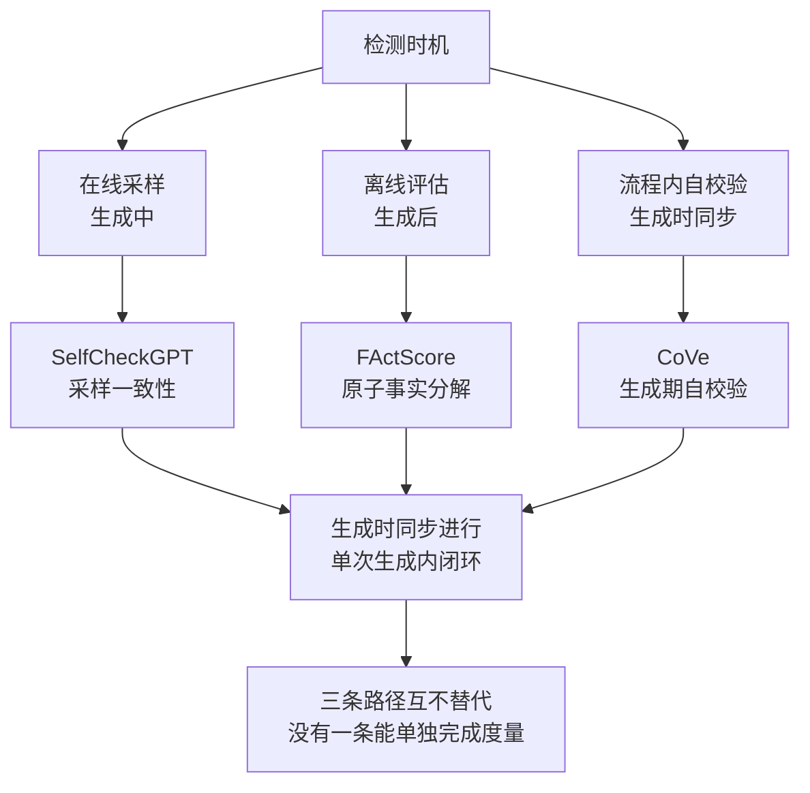

# 幻觉检测三条路径

## 核心结论

**测不到就治不了。** 检测可归为三条路径，分别覆盖在线、离线与流程内三种时机：

| 路径 | 代表方法 | 时机 | 机制 |
|---|---|---|---|
| 黑盒采样一致性 | SelfCheckGPT | 在线 | 多次采样并比对一致性 |
| 原子事实分解 | FActScore | 离线 | 把长回答拆成可独立核查的原子事实 |
| 生成期自校验 | CoVe | 流程内 | 生成后自查再修正 |

**三条路径互不替代**，工程上需按场景组合。

## 要点拆解

### SelfCheckGPT：在线场景的唯一选择

SelfCheckGPT 基于一个直觉：**事实性陈述在多次采样中应稳定复现，编造内容则会前后矛盾**。做法是对同一输入多次采样，用一致性信号（词级、句级或 embedding 距离）给原回答打分。

优点是**无需访问模型内部，黑盒即可**，因此是延迟敏感的线上场景的现实选择；代价是需要多次采样，延迟与成本按采样次数放大。

### FActScore：把「好不好评」变成「可不可评」

FActScore 把一段长回答**拆成若干可独立核查的原子事实**，逐条与知识库比对，输出「正确事实占比」这样的细粒度分数。

它解决了「整体好不好评」的问题，把笼统的流畅度判断变成可操作的检索任务。代价是拆解与比对本身有成本，更适合离线评估。

### CoVe：把校验塞进生成流程

Chain-of-Verification 让模型在**生成初稿后主动列出待核查点、逐条生成验证问题、自答并修正**。它与前两者的区别在于校验与生成同属一次流程，不依赖外部采样或知识库。

优点是流程内闭环、无需外部资源；代价是校验质量受限于模型自身——**用模型去校验模型，上限仍是模型的分布**。

### 为什么不能只用一条

- 只有 SelfCheckGPT：拿不到细粒度归因，不知道错在哪一条。
- 只有 FActScore：无法在线上跑，评估与生产脱节。
- 只有 CoVe：自校验的可靠性本身未被独立度量。

三条覆盖的时机不同，**任何一条单独使用都会留下度量盲区**。

## 相关页面

- [[幻觉三层治理框架]]：检测结论是治理动作的前置输入。
- [[幻觉归因提示词与模型分诊]]：检测之后、治理之前的分诊。
- [[大模型幻觉治理实践]]：三条检测路径在工程中的组合落地。
- [[大模型幻觉技术全景总览]]：本页所属的领域全景。
- [[RAG准确率保障体系]]：本页的检测能力在 RAG 场景中被工程化为三档处置——全部有据放行 / 部分存疑标记 / 完全无据拒答，属防护层事中拦截
- [[领域关键词校验]]：通用检测之外，按关键位点做领域粒度校验，与本页互补
- [[生成侧结构化约束]]：让检测可程序化的前提（输出必须结构化带出处）

## 参考来源

- [[raw/papers/大模型幻觉成因与分层治理.md]]
