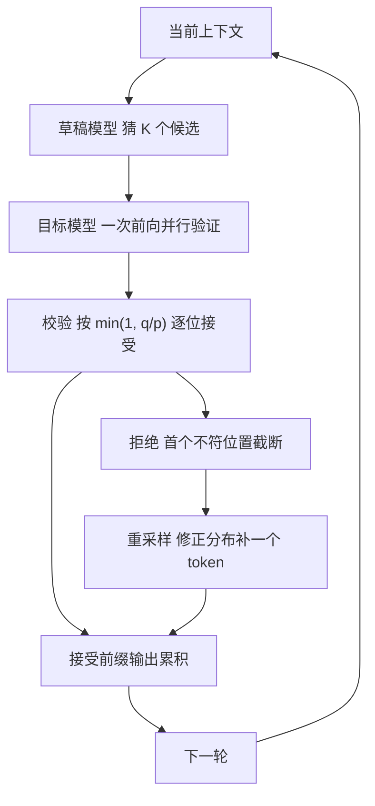

# 投机解码

## 核心结论

投机解码（Speculative Decoding）是一种在**不改变输出分布**的前提下加速大模型 Decode 阶段的推理优化。它的核心洞察是：Decode 阶段受**显存带宽**限制（memory-bound），每步只产出一个 token 却要搬运全量权重；既然如此，不如一次搬完权重、一次并行验证多个候选——**让目标模型并行验证 K 个候选 token，与逐一生成单个 token 成本几乎相同**。

投机解码用一个低成本草稿模型抢先起草一串候选，目标模型一次前向并行验证，按概率匹配逐位接受、在拒绝处从修正分布重采样，从而把"验证 K 个 token"的开销压缩到近似"生成 1 个 token"，同时保持输出分布不变，实现**无损加速** [[1]](#ref-1) [[2]](#ref-2)。

## 机制流程

## 动机：Decode 的 memory-bound 本质

自回归 Decode 每一步都依赖上一步输出、无法并行，天然串行。更关键的是这一阶段受**显存带宽**而非算力限制：模型每前进一步都要把全量权重搬到计算单元，却只换回一个 token 的输出，GPU 算力大量闲置 [[1]](#ref-1)。

两个直觉催生了投机解码：
- **多数 token 相当"好猜"**——冠词、标点、常用短语都有明显高概率答案，不值得让目标模型逐位精算。
- **并行验证 K 个候选与逐一生成本相同**——两者都要把权重读一遍。

## 关键机制要点

- **接受规则**：逐位按 `r = min(1, q/p)` 判定；草稿概率没明显超过目标就接受，过自信（p 明显大于 q）就按比例丢弃。
- **重采样保真**：被拒绝处从修正分布 `P(x) ∝ max(0, q(x) - p(x))` 重采样，保证输出边缘分布恰为目标分布，**无损**由这一步保证。
- **期望接受长度**：单轮目标模型只做一次前向，至多产出 K+1 个 token；收益由草稿与目标分布接近度决定。极端 p≡q 时一轮全接受，反之无收益甚至净负。

## 加速收益

- 原始方案（Leviathan/Chen）常见场景约 **2–3×** Decode 加速 [[1]](#ref-1) [[2]](#ref-2)。
- EAGLE-3 在五项任务上最高 **6.5×** 加速、较 EAGLE-2 提升约 1.4×，SGLang batch size 64 下 1.38× 吞吐提升 [[5]](#ref-5)。
- 本质是**摊薄权重加载**：同一份权重搬运换来更多 token。

## 谱系延伸：自投机线

后续发展把「独立草稿模型」收编进模型自身并决策动态化：LayerSkip 让同一模型浅层当草稿器、全层当验证器，早退与自投机合成端到端方案；SpecEE（ISCA 2025）用投机模型把早退预测器的搜索空间缩小到投机 token 候选上；DEL（COLM 2025）按上下文动态选退出层与草稿长度。接受率经济账与对照详见 [[自适应推理]]。

## 相关概念

- [[投机解码采样机制]]：接受、拒绝、重采样的数学保真
- [[期望接受长度]]：单轮收益的量化刻画
- [[草稿模型分类]]：六类草稿方案与选型
- [[投机解码工程落地]]：vLLM/SGLang 引擎支持与调优
- [[采样解码策略]]：投机解码保留既有采样的一致性
- [[自回归迭代与终止]]：Decode 阶段的串行背景
- [[KV Cache优化技术栈总览]]：投机解码与 KV 优化的正交叠加
- [[自适应推理]]：上游范式，投机解码是其中「解码捷径」支线

## 参考来源

- [[raw/papers/投机解码.md]]

[1] Y. Leviathan et al. "Fast Inference from Transformers via Speculative Decoding." *ICML*, 2023.
[2] C. Chen et al. "Accelerating Large Language Model Decoding with Speculative Sampling." *arXiv:2302.01318*, 2023.
[5] Y. Li, F. Wei, C. Zhang, H. Zhang. "EAGLE-3: Scaling up Inference Acceleration of Large Language Models via Training-Time Test." *NeurIPS*, 2025.