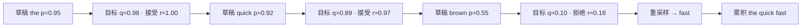

# 投机解码采样机制

## 核心结论

投机解码的采样机制由三部分构成：**逐位接受、拒绝截断与拒绝处重采样**。它们共同保证草稿候选被规范地筛入输出，并维持输出分布不变——这是"无损"的关键 [[1]](#ref-1) [[2]](#ref-2)。

## 三部分机制

### 1. 接受规则：r = min(1, q/p)

**只要草稿的概率没有明显超过目标模型，就接受它**；一旦草稿过自信（p 明显大于 q），就按比例丢弃。形式化为接受概率：

$$r=\min(1,\ q/p)$$

直觉：草稿猜得比目标模型还自信的 token，说明草稿背离了目标分布，可信度打折；反之若目标模型同样看好（甚至更看好），则放心接受 [[1]](#ref-1)。

### 2. 拒绝截断

对每个候选按 `r=min(1,q/p)` 逐位判定。一旦遇到草稿与目标分布分歧大的位置，大概率被拒绝，校验在此**截断**（后续候选不再处理，即使它们概率再高也不进入本轮回溯，因为依赖已被拒绝的前缀）。

### 3. 重采样保真：P(x) ∝ max(0, q(x) - p(x))

在被拒绝的位置，从**修正分布**重新采样：

$$P_{\text{resample}}(x)\ \propto\ \max\big(0,\ q(x)-p(x)\big)$$

可以证明，这使每一步的**边缘分布恰为目标分布 q**——无论草稿模型多差，重采样都能纠正偏差，最终输出与目标模型直接采样完全一致 [[1]](#ref-1) [[2]](#ref-2)。

## 无损性论证

「无损」完全由重采样这一步保证：被拒绝的位置不是简单丢弃，而是从"目标分布高出草稿分布的部分"重采样。这保证了：

- 草稿猜得对的方向被接受、累积；
- 草稿猜错（p 虚高）的方向被纠正、按目标分布补位；
- 每一步的边缘分布始终等于目标 q，与直接逐 token 采样**分布相同**。

## 关键直观

| 情形 | 结果 |
|------|------|
| 草稿 p ≤ 目标 q | 大概率接受，累积 |
| 草稿 p 明显 > 目标 q | 大概率拒绝，在该处截断重采样 |
| 极端 p ≡ q | 一轮全部接受，产出 K 个 token |
| 接受率趋零 | 无收益，甚至因草稿开销转为净负 |

## 相关概念

- [[投机解码]]：机制所属的整体方案
- [[期望接受长度]]：单轮收益的量化刻画
- [[采样解码策略]]：投机解码与既有采样的一致性关系

## 参考来源

- [[raw/papers/投机解码.md]]

[1] Y. Leviathan et al. "Fast Inference from Transformers via Speculative Decoding." *ICML*, 2023.
[2] C. Chen et al. "Accelerating Large Language Model Decoding with Speculative Sampling." *arXiv:2302.01318*, 2023.