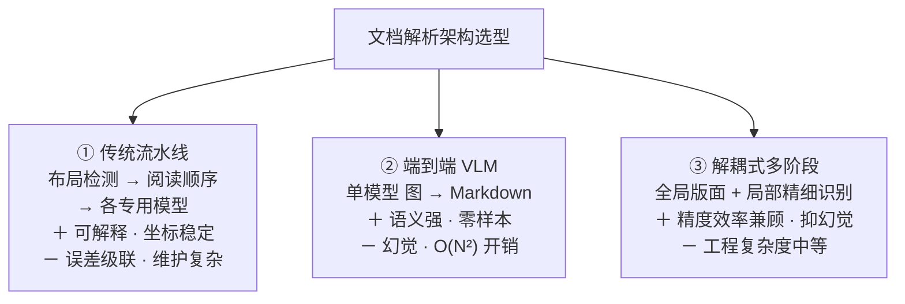

# 文档VLM三大范式

## 简介

文档解析的架构选择可归纳为三条路线，并非"新的取代旧的"，而是精度、成本、可维护性的不同权衡。属 [[文档智能]] 解析段的架构选型层。

## 三大范式

| 范式 | 机制 | 优势 | 短板 |
|---|---|---|---|
| 传统流水线 | 布局检测、阅读顺序、文本/公式/表格各自专用模型 | 可解释、模块可替换、坐标稳定 | 误差级联、维护复杂、复杂版式失效 |
| 端到端 VLM | 单模型直接由图生成 Markdown | 语义强、零样本、架构简单 | 幻觉、高分辨率 O(N²) 开销 |
| 解耦式多阶段 | 阶段一全局版面分析，阶段二局部精细识别 | 兼顾精度与效率、可解释、抑制幻觉 | 工程复杂度中等 |

## 端到端的三个结构性障碍

据 MinerU 2.5 技术报告，端到端在文档场景有三个障碍：

### token 冗余

文档图大量空白/低信息区，原生分辨率编码产生海量视觉 token，O(N²) 复杂度使算力不可承受。

### 幻觉

文本密集区模型倾向"猜"而非"读"，长文档上尤其严重（与 [[文档智能能力边界]] 的"多模态不是银弹"呼应）。

### 分辨率两难

裁剪降低开销但牺牲语义一致性与版面信息；原生分辨率保留细节却产生数量惊人的 token，工程上不可行。

**解法是解耦**：把全局版面分析与局部内容识别拆开，让高分辨率只作用于真正需要精细识别的局部。[[MinerU]] 2.5 是解耦式路线的代表实现（Stage I 整页版面 + Stage II 局部原生分辨率）；[[Docling]] 则以可插拔流水线承接该范式。

## 相关

- 上游：[[OCR文档解析]]、[[版面分析]]、[[表格结构还原]]、[[公式识别]]
- 工具：[[MinerU]]、[[Docling]]
- 引擎：[[文档智能工程落地]]（工程实施）