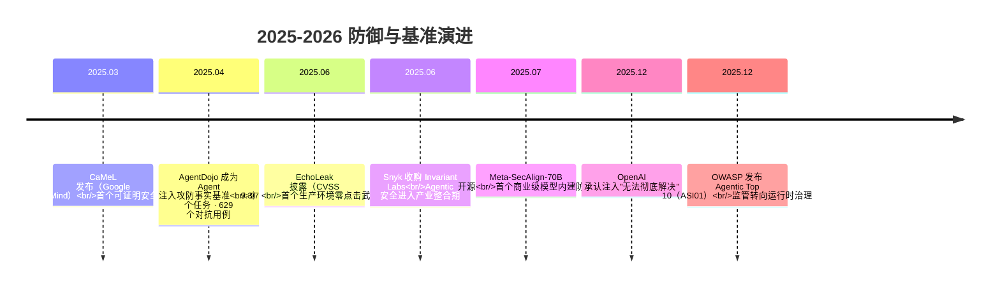

# 新兴 Prompt 注入攻击向量

## 核心结论

- 攻击从"单次输出劫持"演化为多阶段、可持久化、可横向移动的形态。
- 六类新攻击向量需要六类新防线，**红队测试集每半年追加新型载荷**。

## 六类新攻击向量

| 向量 | 机制 | 对应新防线 |
|---|---|---|
| **Promptware Kill Chain** | 七阶段：初始访问→提权越狱→侦察→持久化→命令与控制→横向移动→达成目标 | 按阶段布防，而非只在入口拦截 |
| **记忆投毒/持久化注入** | 注入写入长期记忆跨会话存活 | 记忆签名、来源标记、用户可删、定期审计 |
| **MCP 工具投毒** | 恶意指令藏在 tool description；rug pull（审批后行为突变）；跨工具污染 | 工具描述纳入注入扫描（MCP Scan）、工具行为指纹与版本锁定 |
| **多智能体横向传播** | 被攻陷 Agent 向对等 Agent 传播污点指令 | Agent 间消息同等待遇——校验、溯源、最小权限身份 |
| **Agent Goal Hijack** | 注入不只改单次输出，而是劫持规划与多步行为 | 目标锁定、计划 diff 展示、分层 HITL |
| **语义层隐式注入** | 不靠显式指令字符串，靠文档主题/结构操纵 RAG 排序与摘要倾向 | 检索结果多样性约束、来源配额 |

## 防御与基准演进时间线

<b>图1 2025-2026 防御与基准演进</b>

## 跟踪节奏建议

每季度复盘 OWASP LLM/Agentic 双榜单与 arXiv cs.CR 注入相关论文；持续盯 SecAlign/CaMeL 代码库版本；红队测试集每半年追加新型载荷（记忆投毒、MCP rug pull、多智能体传播三类为当前缺口）。

## 相关页面

- [[Promptware Kill Chain]]：七阶段攻击链全景
- [[Prompt注入攻击类型谱系]]：四类注入载体与已验证案例
- [[Prompt注入分层防御体系]]：按阶段布防的六层体系
- [[Prompt注入验证与运营]]：红队测试集与持续评估

## 参考来源

- [[raw/papers/Prompt注入与防范.md]]
