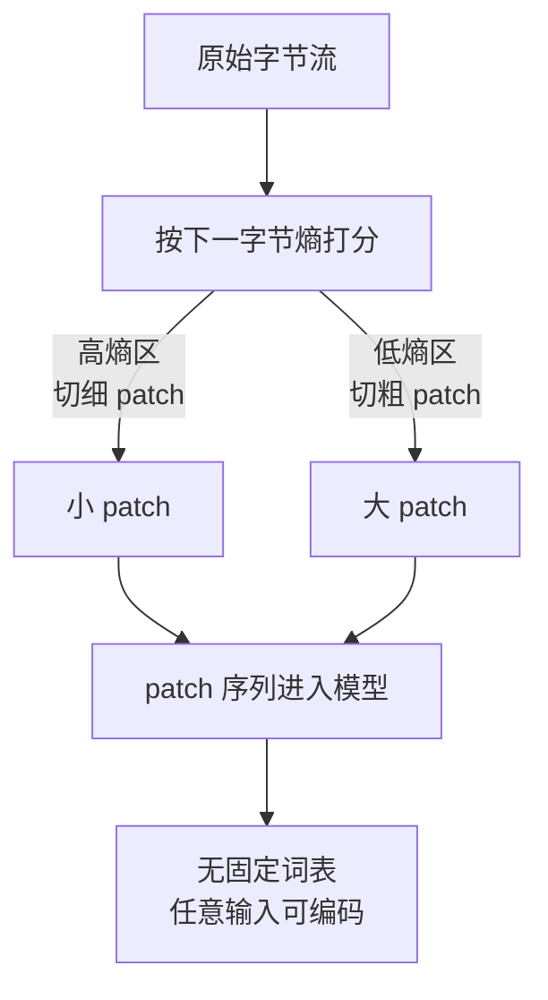

# 无分词器架构

## 核心结论

前沿方向上最值得关注的是无分词器架构：Meta 的 Byte Latent Transformer（BLT）用按下一字节熵动态切分的 patch 取代固定词表 [[5]](#ref-5)，在 8B 参数、4T 字节的受控实验里性能追平基于词表的模型，噪声数据阶段推理 FLOPs 最多省 50%；多模态也在把 Token 泛化，图像 patch 与音频片段纳入同一种 Token 语义。

图 1 BLT 按熵动态切 patch 的机制示意

## 要点拆解

### 动态切 patch 的逻辑

- **熵高（信息密集、难预测）**：切得细，给模型更多区分度；
- **熵低（可预测、冗余）**：切得粗，省算力；
- 与自适应推理里「难处多给算力」的直觉同构——把分词从静态词表查表变成按内容难度动态定粒度。

### 实证结果

- 8B 参数、4T 字节受控实验里性能追平基于词表的模型 [[5]](#ref-5)；
- 噪声数据下与受控推理阶段 FLOPs 最多省 50%；
- 词表的公平问题（低资源语言碎片化、词表偏爱训练语料高频语言）被从根上绕开。

### Token 语义的泛化

多模态把图像 patch 与音频片段纳入同一种 Token 语义，Token 正从文本单元泛化为万物单元；分词这道工序本身正在被按内容难度动态切分的新范式松动。

## 相关页面

- [[词表大小权衡]]：BLT 直接绕开的那道权衡。
- [[分词与模型能力]]：固定词表与切分粒度带来的能力影响，BLT 的对照面。
- [[分词路线演进]]：字节路线推到极致的形态。
- [[Token选择]]：自适应推理侧同构的「难处多算」思想。
- [[Token分词·素材摘要]]：本页所在素材全篇索引。

## 参考来源

[[raw/papers/Token分词.md]]
