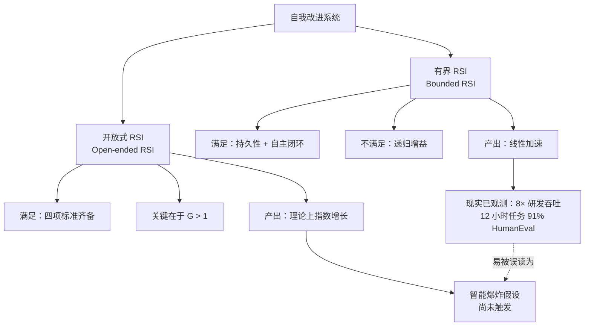

# 有界RSI与开放式RSI

## 核心结论

**有界 RSI 已经是现实，开放式 RSI 还没有。** 把前者观察到的高速增长当成后者的证据，是讨论 RSI 时最常见的错误。

判据回到 [[RSI四项判定标准]] 的第三条：递归增益成立（$G>1$）才从有界跨入开放式。**在此之前，看到的所有惊人数字都是线性加速，不是复利。**

## 要点拆解

### 两者的结构差异

| 维度 | 有界 RSI | 开放式 RSI |
|---|---|---|
| 满足标准 | ①② 持久性 + 自主闭环 | ①②③④ 四项齐备 |
| 递归增益 | 不成立（$G<1$） | 成立（$G>1$） |
| 能力曲线 | 线性 | 理论上指数 |
| 改进收益 | 一次性，不写回改进机制 | 写回机制，下一轮起点更高 |
| 现实状态 | 已大量存在 | 未实现 |

**关键不是「能不能自我改进」，而是「改进能不能让下一次改进更容易」。** 前者有界 RSI 已做到，后者才是开放式。

### 已观测收益属于哪一边

素材给出的四组数字，全部落在**有界 RSI**一侧：

| 观测 | 数值 | 归入 |
|---|---|---|
| 研发吞吐 | 2026 Q2 工程师人均日合并代码量达 2024 年 8 倍；约 130 人调研中位数估 AI 带来约 4 倍产出 | 有界 RSI 线性加速 |
| 长时程自主性 | 任务时长约每四个月翻倍，从约 4 分钟（2024-03）到约 12 小时 | 有界 RSI |
| 封闭域能力 | AlphaGo Zero 无人类数据超越此前所有版本 | 有界 RSI（封闭沙盒） |
| 代码质量 | 自动化审查可拦截约三分之一导致历史事故的缺陷 | 有界 RSI |

**这张表的价值在于反向使用**：凡是能列出「8 倍」「12 小时」这类数字的自我改进，都还是线性加速；真正的开放式 RSI 无法用单点数字描述，只能用一个持续缩短的**迭代周期**来描述。

### 为什么这条区分决定判断方向

若不区分两者，会得出两个相反的错误结论：

- **过度乐观**：「自我改进已经跑起来了，爆炸就在眼前」——把 $G<1$ 的衰减区误判为放大区；
- **过度怀疑**：「自我改进都是噱头，只是提示词戏法」——忽略了有界 RSI 已在真实产出。

正确站位在中间：**有界 RSI 的工程价值已经成立（可用来做研发提效），开放式的安全风险尚未到来但需要前置建模**。这个站位也是素材 §4.3「综合来看」那句结语的落点。

### 跨越边界的唯一条件

从有界到开放式，唯一条件是反馈环弹性乘积 $G=\prod_{i=1}^{n}\epsilon_i > 1$。现有数据显示反馈环尚不足自我维持加速，但正在增强——**这意味着边界在移动，不是固定不变的**。

量化推导与「信封估算」的方法见 [[点火条件与复利因子G]]。

## 相关页面

- [[RSI四项判定标准]]：有界与开放式的判定依据。
- [[点火条件与复利因子G]]：跨越边界的量化条件 $G>1$。
- [[递归自我改进RSI]]：定义与概念边界。
- [[Agent训练方法阶梯]]：L3 持续自我改进，是有界 RSI 在 Agent 工程中的形态。
- [[递归自我改进总览]]：本页所属的领域全景。

## 参考来源

- 线上原文：[https://www.anthropic.com/institute/recursive-self-improvement](https://www.anthropic.com/institute/recursive-self-improvement)（Anthropic Institute, 2026）
- 线上原文：[https://arxiv.org/abs/2609.15802](https://arxiv.org/abs/2609.15802)（The Economics of Recursive Self-Improvement）
- [[raw/papers/RSI递归自我改进.md]]（§3.3 有界实证、§4.1 已观测收益、§4.3 局限与边界）
