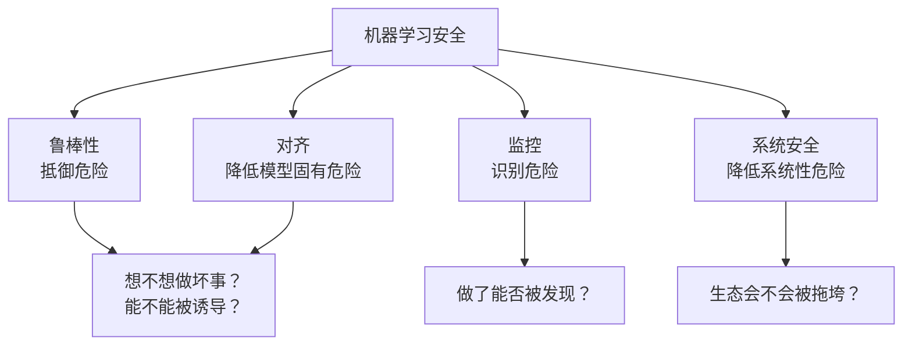

# 机器学习安全四大类别

## 架构总览

<b>图1 机器学习安全四大类别与逻辑分工</b>

## 核心结论

- **四类相互嵌套，类似安全工程中的瑞士奶酪模型**——多层防御叠加，单点失效不致命[[1]](#ref-1)。
- 逻辑分工：**对齐**解决「模型想不想做坏事」、**鲁棒性**解决「能不能被诱导做坏事」、**监控**解决「做了能否被发现」、**系统安全**解决「整个生态会不会被拖垮」。
- 四类各自回答不同的危险来源（模型固有、外部扰动、运行期异常、部署环境），因此不能相互替代。

## 要点拆解

| 类别 | 关注点 | 核心目标 | 典型问题 | 防御方向 |
|---|---|---|---|---|
| 鲁棒性 | 抵御危险 | 在分布偏移与对抗扰动下维持稳定表现 | 对抗样本、后门触发、长尾事件崩塌 | 对抗训练、认证防御、OOD 泛化 |
| 监控 | 识别危险 | 运行时持续捕捉异常行为与恶意使用 | 不确定性估计失效、后门潜伏 | 不确定性量化、异常检测、可解释性 |
| 对齐 | 降低模型固有危险 | 让模型实际追求的目标契合设计者意图 | 奖励黑客、欺骗性对齐、奉承倾向 | RLHF、宪法式训练、可扩展监督 |
| 系统安全 | 降低系统性危险 | 处理部署环境与社会条件带来的集体风险 | 攻防失衡、机构决策失灵、逐底竞争 | 网络防御、机构治理、部署前承诺 |

- 本页是[[AI安全定义与边界]]中三类风险（事故/滥用/有害后果）的技术落地版：突出「怎么防」而非「防什么」。
- 第四类「系统安全」是[[红队测试边界与军备竞赛]]里「攻防失衡」的结构性根源——单点技术再强也挡不住生态层面的逐底竞争。

## 相关页面

- [[AI安全与红队测试总览]]：本页所在的上位总览
- [[AI安全定义与边界]]：防御对象——事故/滥用/有害后果三分类
- [[三大威胁向量]]：鲁棒性/对齐之外的攻击面（越狱/提示注入/内容安全）
- [[红队测试边界与军备竞赛]]：系统安全层面「攻防失衡」的延伸
- [[纵深防御五原则]]：防御工程学视角的并行互补原则
- [[递归自我改进RSI]]：对齐类别在跨代自我改进场景下的极端形态——微小偏差跨代放大即「对齐退化」

## 参考来源

- [[raw/papers/AI安全与红队测试.md]]

---

[1] D. Hendrycks, N. Carlini, J. Schulman, and J. Steinhardt. [Unsolved Problems in ML Safety](https://arxiv.org/abs/2109.13916) *arXiv:2109.13916*, 2021.
