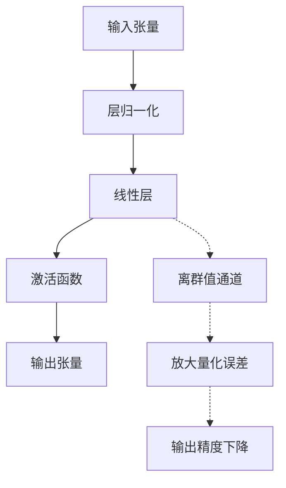

# 权重量化

## 核心结论

权重量化把 FP16/FP32 权重映射到 INT8/INT4/FP8 等低比特，在可控精度损失下实现显存压缩与推理加速：70B 模型 FP16 需约 140 GB HBM，压到 4-bit 即可装入单张 H100，解码阶段的矩阵乘还能借带宽节省释放数倍吞吐 [[1]](#ref-1)。它无需改动网络拓扑、无需训练、压缩比高，是压缩版图里工程优先级最高的标配路径；核心矛盾是激活离群值，把权重量化等同于等比例加速是最大误读。

图 1 Transformer 推理流水线中激活离群值的作用示意

## 要点拆解

### 两大动机

- **显存**：把权重从 2 字节压到 0.5 字节，让 70B 模型装入单卡；
- **带宽**：解码是带宽受限阶段，权重变小等于每步搬运量变小，吞吐成倍释放 [[1]](#ref-1)。

### 基础原理

量化的本质是仿射变换把浮点张量映射到低比特整数网格：缩放因子 $s$ 定步长，零点 $z$ 把整数 0 对齐浮点 0。对称量化（$z=0$）适配合零中心分布的权重，非对称量化适应分布偏移的激活。粒度从 Per-tensor 到 Per-channel、Per-group、Per-block + Super-block 逐级变细，粒度越细精度越高、元数据开销越大；静态量化离线算好 scale 存进权重文件，动态量化对激活在推理时按 batch 在线算。详见 [[PTQ与QAT对比]] 的流程分类。

### 压缩技术版图中的定位

与剪枝（改连接结构）、知识蒸馏（需额外训练）、低秩分解（受秩假设限制）相比，权重量化不动拓扑、不训练、压缩比高，是从 checkpoint 走向生产部署的标配 [[10]](#ref-10)。

### 三类量化对象

- **仅权重**（W8A16/W4A16）：激活保留 FP16，矩阵乘仍在 FP16 执行，加速来自带宽节省，解码收益显著；
- **权重与激活联合**（W8A8/FP8）：才能真正用上 Hopper 架构的低比特 Tensor Core，前提是先过 [[SmoothQuant]] 这类等价变换治激活离群值；
- **KV Cache**：长上下文下可能反超权重本身，须与权重协同量化，详见 [[KV Cache 量化]]。

### 算法与生态

算法按核心思想分六族（混合精度/Hessian 误差补偿/激活感知缩放/等价变换/非均匀码本/非相干+格点码本），GPTQ 与 AWQ 是 INT4 推理常用方案，详见 [[GPTQ]]、[[AWQ]]、[[主流量化算法对比]]；本地部署走 [[K-quants]]（llama.cpp），极限低比特走 [[极限低比特量化]]；工具链与 kernel 见 [[量化工具链与kernel]]，选型避坑见 [[量化选型与避坑]]。

## 相关页面

- [[KV Cache 量化]]：长上下文下与权重量化协同的另一半。
- [[PTQ与QAT对比]]：训练后量化与量化感知训练的流程取舍。
- [[GPTQ]]、[[AWQ]]、[[SmoothQuant]]、[[NF4 量化]]、[[K-quants]]、[[极限低比特量化]]：六族代表算法。
- [[主流量化算法对比]]：七算法七维总对照。
- [[量化工具链与kernel]]：Marlin/TinyChat 与六套工具链生态。
- [[量化选型与避坑]]：决策流程与八条避坑清单。
- [[权重量化·素材摘要]]：本素材全篇要点索引。

## 参考来源

[[raw/papers/权重量化.md]]
