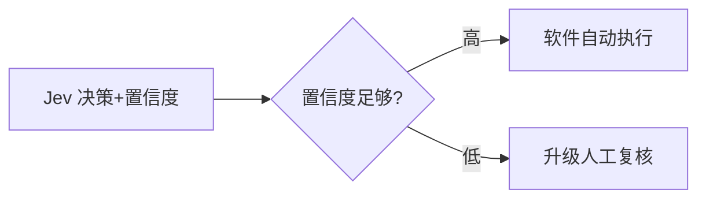

# 校准置信度

## 定义

**校准置信度**指每个决策自带一个**校准过的概率**，让软件判断何时可自动执行、何时应升级给人工复核。这是 Jev 面向机器接口的关键机制。

## 关键内涵

- 每个决策带概率，软件借此决定**自动执行 vs 转人工复核**。
- 是「软件可以直接依赖的判断接口」的价值所在——可信、可审计。
- 配合 [[类型化输出]]、[[并行采样机制]] 构成 System One 模型的完整原理。见 [[Jev 决策模型]]。

## 使用价值

把不可靠输出挡在自动化流水线之外：高置信度自动执行、低置信度升级人工。这是与传统 LLM「每次措辞不同、无可靠置信度」的显著区别。见 [[Jev 与传统 LLM 对比]]。

## 相关导航

- 模型：[[Jev 决策模型]]
- 品类：[[System One 模型]]
- 原理：[[类型化输出]]、[[并行采样机制]]、[[决策原语]]
- 落地：[[Jev 应用与落地]]
- 总览：[[Jev 决策模型总览]]

