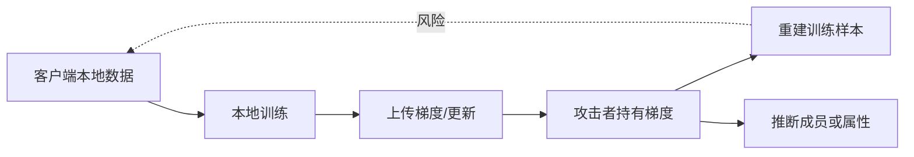

# 梯度泄露攻击

## 核心结论

**「不上传原始数据即不泄露隐私」是一种误判。**

深度梯度泄露工作（Deep Leakage from Gradients, DLG, NIPS 2019）证明：**仅凭共享的梯度，攻击者即可重建训练数据**。因此直接上传梯度并不构成安全边界，隐私保障必须由额外机制（[[安全聚合SecAgg]]、[[差分隐私]]、TEE）承担。

## 要点拆解

### 为什么梯度能反推数据

梯度是损失函数对参数的导数，而损失由「输入样本 + 标签 + 当前参数」共同决定。给定模型结构（联邦场景通常公开）与梯度，理论上就构成对输入的约束方程组——在小批量、基础架构等条件下可被优化求解，从而重建出接近原始的样本。

### 三类攻击与目标

| 攻击类型 | 目标 | 典型效果 |
|---|---|---|
| 成员推断 | 判断某条记录是否参与了训练 | 在位置签到类数据集上有工作报告接近 0.99 的准确率 |
| 属性推断 | 判断训练集是否含某敏感属性 | 属性可与主任务无关（如是否戴眼镜），仍能缩小身份范围 |
| 模型反演 | 生成与训练集同分布的样本 | 用 GAN 从更新中生成原型样本，在分类样本彼此相似的任务上尤其强 |

**上述数字高度依赖数据集与模型设置，不宜外推为通用结论**；但三者共同表明：隐私风险具备可实证、可量化的性质。

### 对防护设计的约束

| 结论 | 设计要求 |
|---|---|
| 单靠「不上传数据」不够 | 必须叠加密码学或扰动机制 |
| 攻击可在无先验知识下进行 | 不能假设攻击者不了解训练集 |
| 分类样本越相似越易反演 | 人脸、医疗影像等任务风险更高 |

这也是「数据不出域只是起点，不是结论」的来源。

## 相关页面

- [[联邦学习]]：本页所属的范式定义。
- [[安全聚合SecAgg]]：阻断服务器侧个体可见性的第一道防线。
- [[差分隐私]]：扰动聚合结果，降低可推断性。
- [[联邦学习总览]]：风险与防护在领域全景中的位置。

## 参考来源

- [[raw/papers/联邦学习.md]]（§3.3 梯度泄露）
- 线上原文：[https://arxiv.org/abs/1906.08935](https://arxiv.org/abs/1906.08935)（Zhu 等，NIPS 2019）
