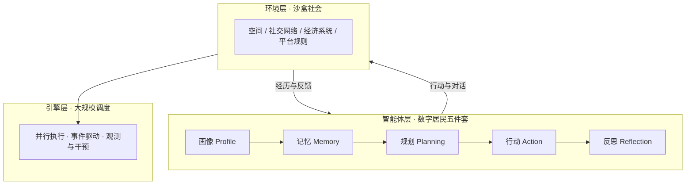

# 沙盒社会三层架构

## 核心结论

现有大规模智能体仿真平台的骨架高度一致，可拆成三层：智能体层的五件套决定「居民像不像人」，环境层的社会容器决定「社会像不像社会」，引擎层的调度能力决定「跑不跑得动」。记住居民、环境、引擎，就能对上所有平台三代谱系。

图 1 沙盒社会三层参考架构

## 要点拆解

### 三层分工

- **智能体层**：画像给身份，记忆给连续性，规划给主动性，反思把经历沉淀成稳定态度（详见 [[数字居民]]）；
- **环境层**：空间布局、社交网络拓扑与经济约束共同框定交互的可能——环境是涌现的模具，小镇、社交媒体、经济体只是同构的不同皮肤；
- **引擎层**：千级以上规模靠并行调度与事件驱动，配套观测面板与干预接口，否则百万智能体只是高成本的黑箱。

### 层间的双向循环

行动与对话从居民流向社会，经历与反馈从社会流回居民——涌现现象只诞生在这个循环里，任何一层偷工都会让循环断流：居民太弱则行为不可信，环境太简则无处涌现，引擎太弱则循环跑不动。

### 平台对照

五个代表平台就是同一骨架上的不同取值：Generative Agents 把智能体层做到可信（25 人）；[[AgentSociety]] 把引擎层与社会科学分析工具做齐；[[OASIS]] 把环境层做成百万级社交媒体；[[Project Sid]] 把环境层的经济与治理结构做深。谱系对照详见大规模智能体仿真主页面。

## 相关页面

- [[大规模智能体仿真]]：三层架构所属的上位概念与平台谱系索引。
- [[数字居民]]：智能体层的五件套拆解。
- [[AgentSociety]]、[[OASIS]]、[[Project Sid]]、[[Generative Agents]]：同一骨架的四类取值。

## 参考来源

[[raw/papers/大规模智能体仿真.md]]
