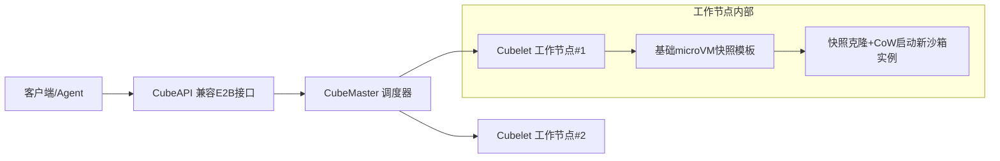

# 沙箱冷启动加速技术

## 核心结论

**冷启动是 Agent 沙箱的头等指标**——Agent 要频繁、短时、大批量创建一次性执行环境，冷启动因此从边缘指标跃升为核心约束。而安全强度与启动开销总体反向，破局手段是**预热池、快照恢复与分支式沙箱**，把有效冷启动压低一个数量级。

## 要点拆解

### 腾讯云 CubeSandbox 的两板斧

架构分**控制面 + 工作节点（Node）**：

- **控制面**：CubeAPI 对外暴露兼容 E2B 接口，CubeMaster 负责调度；
- **工作节点**：Cubelet 基于 KVM 启动轻量化 microVM 实例。

启动加速靠**「预置快照 + 写时复制 CoW（Copy-on-Write）」**：

1. 预先初始化干净 microVM 并快照，新请求**直接克隆**，启动延迟压至 **60ms 以内**；
2. 内存页按写时复制共享，单沙箱基础内存仅约 **5MB**；
3. 实测 50 并发 **P99 ≈ 150ms**。

### 快照克隆与预热池是同源思路

Google Agent Sandbox 以 Kubernetes CRD 提供，用 **SandboxWarmPool 常驻预热 microVM** 实现即时领取——与 CubeSandbox 的快照克隆思路同源，都是「把初始化成本从关键路径挪到池子里」。

这条思路在 [[Agent沙箱平台横评]] 中反覆出现，是当前各家一致的加速方向。

### 它们对应谱系上的哪一档

被加速的对象是 [[Firecracker微虚拟机]]（约 125ms 起），加速后进入 60ms 区间；而 [[gVisor用户态内核]] 与 [[OS原语沙箱机制]] 本身启动就更快，加速手段转向进程池与镜像预热。四层栈中的**状态管理层（快照）**正是本页能力的归属，见 [[沙箱四层技术栈]]。

## 相关页面

- [[隔离技术谱系]]：启动开销是权衡链的横轴。
- [[Firecracker微虚拟机]]：被加速的隔离载体本体。
- [[沙箱四层技术栈]]：快照能力在四层架构中的位置。
- [[沙箱选型权衡与落地避坑]]：冷启动作为头等指标的完整权衡。
- [[Agent沙箱技术全景总览]]：本页所属的领域全景。

## 参考来源

- [[raw/papers/Agent沙箱.md]]
