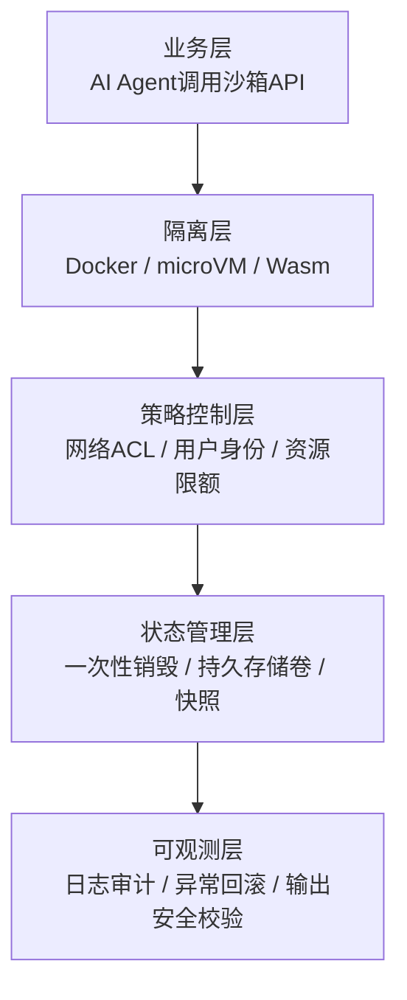

# 沙箱四层技术栈

## 核心结论

完整的企业级 Agent 沙箱由**隔离层-策略控制层-状态管理层-可观测层**四层构成。单靠隔离层选对载体远远不够——[[容器逃逸与沙箱绕过]] 的四类逃逸面中，元数据、DNS 外泄与 jailer 缺陷都落在隔离层之外，必须由上三层接住。

## 要点拆解

| 层 | 职责 |
|---|---|
| **隔离层** | 根据风险等级选择底层隔离载体，选型参见 [[沙箱隔离技术选型对比]] |
| **策略控制层** | 网络默认拒绝、按需白名单；强制普通用户运行；CPU/内存硬限制；监控内核 OOM（内存溢出，退出码 137） |
| **状态管理层** | 临时任务执行完立刻销毁；长期任务挂载独立存储卷 |
| **可观测层** | 全操作留痕；快照快速回滚；输出独立安全扫描，**禁止 Agent 自证安全** |

**「禁止 Agent 自证安全」** 是可观测层最关键的一条：验证者必须独立于执行者，与 [[独立验证机制]] 的「别让一个节点既写答案又批卷子」是同一原则。

### 退出码 137 的监控含义

资源超限被内核强制杀死（退出码 137）时，**Agent 收不到异常回调**，必须外置监控兜底——这一条在 [[沙箱选型权衡与落地避坑]] 中作为第三条误区展开。

## Dify 落地案例

Dify 将**代码节点和命令行工作区拆分为两套独立沙箱，不可混用**，配置摘自官方部署文档：

| | 代码节点沙箱 | 命令行工作区沙箱 |
|---|---|---|
| 镜像 | `langgenius/dify-sandbox:0.2.0` | `langgenius/dify-agent-local-sandbox:1.17.1` |
| 隔离 | 根目录只读，禁止写入临时目录，屏蔽密钥文件；网络默认关闭 | 可写工作目录 + `/dependencies`、`/conf` 持久卷；外网经由 SSRF 防护代理（防内网探测）白名单放行 |
| 资源上限 | CPU≤0.5，RAM≤512MB，超时 5s | CPU≤2，RAM≤2GB，超时 300s |

两套沙箱的差异体现了**按风险定策略**：只读代码执行给最紧的 CPU 与 5 秒超时、彻底断网；需要装依赖的命令行工作区给更大资源，但外网必须过 SSRF 防护代理的白名单。

## 相关页面

- [[隔离技术谱系]]：隔离层的选型依据。
- [[容器逃逸与沙箱绕过]]：为什么上三层是必需而非可选。
- [[沙箱冷启动加速技术]]：状态管理层「快照」能力的加速细节。
- [[沙箱选型权衡与落地避坑]]：四层之上的落地误区。
- [[Agent沙箱技术全景总览]]：本页所属的领域全景。

## 参考来源

- [[raw/papers/Agent沙箱.md]]
